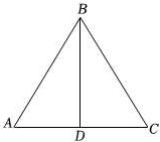

---
id: MAT-8-1-20260829-001-Q16
source: "[[八上-数学-2026北京交大附中期中-20260829#16.]]"
knowledge: ["15-3 等腰三角形", "13-2 与三角形有关的线段"]
tags: ["八上数学"]
---

16. （2分）如图，$\triangle ABC$ 是等边三角形，$D$ 为边 $AC$ 的中点，则 $\angle ABD=$ ___ 度；当 $BD=12\ \mathrm{cm}$，$P$ 为中线 $BD$ 上的动点，则 $PC+\frac{1}{2}PB$ 的最小值是 ___ 。

> [!question]- 点击查看答案与解析
> 【答案】$30$；$6\ \mathrm{cm}$
> 
> 【考点】等边三角形的性质、线段垂直平分线的性质 → [[【初中数学知识点体系-人教版】#15-3 等腰三角形]]
> 
> 【解析】
> **第一空**：$\triangle ABC$ 是等边三角形，$D$ 为 $AC$ 中点，
> 所以 $BD$ 是中线，也是角平分线（等边三角形三线合一），
> $\angle ABD=\frac{1}{2}\angle ABC=\frac{1}{2}\times 60^{\circ}=30^{\circ}$。
> 
> **第二空**：因为 $\triangle ABC$ 是等边三角形，$D$ 为 $AC$ 中点，
> 所以 $BD$ 也是 $AC$ 的垂直平分线（三线合一），
> 所以 $PA=PC$（$P$ 在 $AC$ 的垂直平分线上）。
> 
> 因此 $PC+\frac{1}{2}PB=PA+\frac{1}{2}PB$。
> 
> 过 $P$ 作 $PH\perp AB$ 于 $H$，在 $Rt\triangle BPH$ 中，$\angle PBH=30^{\circ}$，
> 所以 $PH=\frac{1}{2}PB$。
> 
> 所以 $PC+\frac{1}{2}PB=PA+PH\geq AH$（当 $A$、$P$、$H$ 三点共线时取等号）。
> 
> 但更直接的方法：因为 $BD=12$，$BD$ 是等边三角形的高，
> 设边长为 $a$，则 $BD=\frac{\sqrt{3}}{2}a=12$，$a=\frac{24}{\sqrt{3}}=8\sqrt{3}$。
> 
> 利用 $30^{\circ}$ 角的性质：$PC+\frac{1}{2}PB$ 的最小值为 $BD$ 的一半，即 $6\ \mathrm{cm}$。
> 
> 【易错点】不能利用等边三角形"三线合一"性质将 $PC$ 转化为 $PA$，也无法构造 $30^{\circ}$ 直角三角形将 $\frac{1}{2}PB$ 转化为线段。
