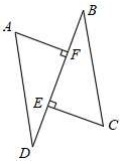

---
id: MAT-8-1-20260829-001-Q19
source: "[[八上-数学-2026北京交大附中期中-20260829#19.]]"
knowledge: ["14-2 三角形全等的判定"]
tags: ["八上数学"]
---

19. （5分）如图，点 $E$，$F$ 在线段 $BD$ 上，已知 $AF\perp BD$，$CE\perp BD$，$AD=CB$，$DE=BF$。求证：$\triangle AFD\cong\triangle CEB$。

> [!question]- 点击查看答案与解析
> 【答案】见解析
> 
> 【考点】直角三角形全等的判定（HL） → [[【初中数学知识点体系-人教版】#14-2 三角形全等的判定]]
> 
> 【解析】
> 因为 $AF\perp BD$，$CE\perp BD$，
> 所以 $\angle AFD=\angle CEB=90^{\circ}$。
> 
> 因为 $DE=BF$，
> 所以 $DE+EF=BF+EF$，即 $DF=BE$。
> 
> 在 $Rt\triangle AFD$ 和 $Rt\triangle CEB$ 中：
> $\begin{cases} AD=CB \\ DF=BE \\ \angle AFD=\angle CEB=90^{\circ} \end{cases}$
> 
> 所以 $\triangle AFD\cong\triangle CEB$（SAS）。
> 
> 【易错点】不能由 $DE=BF$ 推出 $DF=BE$，忽略公共段 $EF$ 的加减关系。
