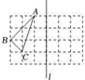

---
id: MAT-8-1-20260829-001-Q21
source: "[[八上-数学-2026北京交大附中期中-20260829#21.]]"
knowledge: ["15-2 画轴对称的图形"]
tags: ["八上数学"]
---

21. （5分）如图，在边长为 $1$ 的小正方形方格纸中，有一个以格点为顶点的 $\triangle ABC$，利用无刻度直尺作图。

（1）画 $\triangle A'B'C'$，使它与 $\triangle ABC$ 关于直线 $l$ 对称；

（2）$\triangle ABC$ 的面积是 ___ ；

（3）在直线 $l$ 上找一点 $Q$，使点 $Q$ 到 $AB$、$BC$ 两边的距离相等。

> [!question]- 点击查看答案与解析
> 【答案】
> （2）$\frac{3}{2}$
> （3）$Q$ 为 $\angle ABC$ 的平分线与直线 $l$ 的交点
> 
> 【考点】轴对称作图、三角形面积、角平分线的性质 → [[【初中数学知识点体系-人教版】#15-2 画轴对称的图形]]
> 
> 【解析】
> （1）分别作 $A$、$B$、$C$ 关于直线 $l$ 的对称点 $A'$、$B'$、$C'$，连接即可。
> 
> （2）利用割补法：$\triangle ABC$ 所在矩形面积减去三个直角三角形面积，
> 设矩形为 $2\times 3=6$，三个三角形面积分别为 $\frac{1}{2}\times 1\times 2=1$、$\frac{1}{2}\times 1\times 3=\frac{3}{2}$、$\frac{1}{2}\times 2\times 1=1$，
> 所以 $\triangle ABC$ 面积 $=6-1-\frac{3}{2}-1=\frac{3}{2}$。
> 
> （3）点 $Q$ 到 $AB$、$BC$ 距离相等，则 $Q$ 在 $\angle ABC$ 的平分线上。
> 又 $Q$ 在直线 $l$ 上，所以 $Q$ 是 $\angle ABC$ 的平分线与直线 $l$ 的交点。
> 
> 【易错点】第（3）问不能将"到两边距离相等"转化为"在角平分线上"这一条件。
