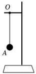
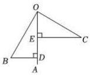

---
id: MAT-8-1-20260829-001-Q22
source: "[[八上-数学-2026北京交大附中期中-20260829#22.]]"
knowledge: ["14-1 全等三角形及其性质", "14-2 三角形全等的判定"]
tags: ["八上数学"]
---

22. （5分）小明在物理课上学习了发声物体的振动实验后，对其做了进一步的探究：在一个支架的横杆点 $O$ 处用一根细绳悬挂一个小球，小球可以自由摆动，如图，$A$ 表示小球静止时的位置。当小明用发声物体靠近小球时，小球从 $A$ 摆到 $B$ 位置，此时过点 $B$ 作 $BD\perp OA$ 于点 $D$，当小球摆到 $C$ 位置时，$OB$ 与 $OC$ 恰好垂直（图中的点 $A$，$B$，$O$，$C$ 在同一平面内），过点 $C$ 作 $CE\perp OA$ 于点 $E$，测得 $CE=15\ \mathrm{cm}$，$BD=8\ \mathrm{cm}$。

（1）求证：$OE=BD$；

（2）求 $DE$ 的长。

> [!question]- 点击查看答案与解析
> 【答案】
> （2）$DE=7\ \mathrm{cm}$
> 
> 【考点】全等三角形的判定（AAS） → [[【初中数学知识点体系-人教版】#14-2 三角形全等的判定]]
> 
> 【解析】
> （1）因为 $BD\perp OA$，$CE\perp OA$，
> 所以 $\angle BDO=\angle OEC=90^{\circ}$。
> 
> 因为 $OB\perp OC$，所以 $\angle BOC=90^{\circ}$，
> 所以 $\angle BOD+\angle COE=90^{\circ}$。
> 
> 又 $\angle BDO=90^{\circ}$，所以 $\angle BOD+\angle OBD=90^{\circ}$，
> 所以 $\angle OBD=\angle COE$。
> 
> 在 $\triangle OBD$ 和 $\triangle COE$ 中：
> $\begin{cases} \angle BDO=\angle OEC=90^{\circ} \\ \angle OBD=\angle COE \\ OB=OC（绳长不变） \end{cases}$
> 
> 所以 $\triangle OBD\cong\triangle COE$（AAS），
> 所以 $OE=BD=8\ \mathrm{cm}$。
> 
> （2）由 $\triangle OBD\cong\triangle COE$ 得 $OD=CE=15\ \mathrm{cm}$，
> 所以 $DE=OD-OE=15-8=7\ \mathrm{cm}$。
> 
> 【易错点】不能从 $OB\perp OC$ 和 $BD\perp OA$、$CE\perp OA$ 推导出 $\angle OBD=\angle COE$，缺少关键的等角转化。
