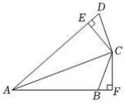

---
id: MAT-8-1-20260829-001-Q23
source: "[[八上-数学-2026北京交大附中期中-20260829#23.]]"
knowledge: ["14-3 角的平分线"]
tags: ["八上数学"]
---

23. （5分）如图，$CB=CD$，$\angle D+\angle ABC=180^{\circ}$，$CE\perp AD$ 于点 $E$，$CF\perp AB$ 交 $AB$ 的延长线于点 $F$。

（1）求证：$AC$ 平分 $\angle DAB$。

（2）若 $AE=a$，$DE=b$，求 $AB$ 的长。（用含 $a$，$b$ 的代数式表示）

> [!question]- 点击查看答案与解析
> 【答案】
> （2）$AB=a-b$
> 
> 【考点】角平分线的性质和判定 → [[【初中数学知识点体系-人教版】#14-3 角的平分线]]
> 
> 【解析】
> （1）因为 $CE\perp AD$，$CF\perp AB$，
> 所以 $\angle CED=\angle CFB=90^{\circ}$。
> 
> 因为 $\angle D+\angle ABC=180^{\circ}$，且 $\angle ABC+\angle CBF=180^{\circ}$，
> 所以 $\angle D=\angle CBF$。
> 
> 在 $\triangle CED$ 和 $\triangle CFB$ 中：
> $\begin{cases} \angle CED=\angle CFB=90^{\circ} \\ \angle D=\angle CBF \\ CD=CB \end{cases}$
> 
> 所以 $\triangle CED\cong\triangle CFB$（AAS），
> 所以 $CE=CF$。
> 
> 因为 $CE\perp AD$，$CF\perp AB$，且 $CE=CF$，
> 所以点 $C$ 在 $\angle DAB$ 的平分线上（到角两边距离相等的点在角的平分线上），
> 即 $AC$ 平分 $\angle DAB$。
> 
> （2）因为 $AC$ 平分 $\angle DAB$，$CE\perp AD$，$CF\perp AB$，
> 由 $\triangle CED\cong\triangle CFB$ 得 $DE=BF=b$。
> 
> 在 $Rt\triangle ACE$ 和 $Rt\triangle ACF$ 中：
> $\begin{cases} AC=AC \\ CE=CF \end{cases}$
> 
> 所以 $Rt\triangle ACE\cong Rt\triangle ACF$（HL），
> 所以 $AF=AE=a$。
> 
> 因为 $AB=AF-BF$，所以 $AB=a-b$。
> 
> 【易错点】不能利用 $\angle D+\angle ABC=180^{\circ}$ 推出 $\angle D=\angle CBF$，缺少补角的等量代换。
