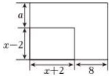

---
id: MAT-8-1-20260829-001-Q24
source: "[[八上-数学-2026北京交大附中期中-20260829#24.]]"
knowledge: ["16-2 整式的乘法", "16-3 乘法公式"]
tags: ["八上数学"]
---

24. （7分）阅读材料：

类比是常用的数学思想。比如，我们可以类比多位数的竖式运算方法，得到多项式与多项式的运算方法。

$\begin{array}{r}2x+3\\+3x-5\\\hline5x-2\end{array}$

$\therefore (2x+3)+(3x-5)=5x-2$

$\begin{array}{r}3x^{2}-4x+1\\-(x^{2}+0-5)\\\hline2x^{2}-4x+6\end{array}$

$\therefore (3x^{2}-4x+1)-(x^{2}-5)=2x^{2}-4x+6$

$\begin{array}{rr}& 2x+5\\\times & x+3\\\hline& 6x+15\\& +(2x^{2}+5x)\\\hline& 2x^{2}+11x+15\end{array}$

$\therefore(x+3)(2x+5)=2x^{2}+11x+15$

理解应用：

（1）请仿照上面的竖式方法计算：$(2x+3)(x-5)$；

（2）已知两个多项式的和为 $3x^{2}-\frac{7}{2}x+5$，其中一个多项式为 $x^{2}-2$，请用竖式的方法求出另一个多项式。

（3）已知一个长为 $(x+2)$、宽为 $(x-2)$ 的长方形 $A$，将它的长增加 $8$，宽增加 $a$，得到一个新长方形 $B$（如图），若长方形 $B$ 的周长是 $A$ 的周长的 $3$ 倍，求长方形 $B$ 的面积（用含 $x$ 的代数式表示）。

> [!question]- 点击查看答案与解析
> 【答案】
> （1）$(2x+3)(x-5)=2x^{2}-7x-15$
> （2）另一个多项式为 $2x^{2}-\frac{7}{2}x+7$
> （3）长方形 $B$ 的面积为 $(x+10)(x-2+a)$，需先求出 $a$ 与 $x$ 的关系
> 
> 【考点】多项式乘法、整式的加减 → [[【初中数学知识点体系-人教版】#16-2 整式的乘法]]
> 
> 【解析】
> （1）竖式计算：
> $\begin{array}{rr}& 2x+3\\\times & x-5\\\hline& -10x-15\\& +(2x^{2}+3x)\\\hline& 2x^{2}-7x-15\end{array}$
> 
> 所以 $(2x+3)(x-5)=2x^{2}-7x-15$。
> 
> （2）设另一个多项式为 $P$，则 $P+(x^{2}-2)=3x^{2}-\frac{7}{2}x+5$，
> 所以 $P=3x^{2}-\frac{7}{2}x+5-(x^{2}-2)=2x^{2}-\frac{7}{2}x+7$。
> 
> （3）长方形 $A$ 的周长 $=2[(x+2)+(x-2)]=2(2x)=4x$。
> 长方形 $B$ 的长为 $(x+2)+8=x+10$，宽为 $(x-2)+a=x-2+a$。
> 长方形 $B$ 的周长 $=2[(x+10)+(x-2+a)]=2(2x+8+a)=4x+16+2a$。
> 
> 由题意：$4x+16+2a=3\times 4x=12x$，
> 所以 $2a=8x-16$，$a=4x-8$。
> 
> 长方形 $B$ 的面积 $=(x+10)(x-2+a)=(x+10)(x-2+4x-8)=(x+10)(5x-10)=5(x+10)(x-2)$。
> 
> 【易错点】第（3）问不能正确建立周长关系式求出 $a$，导致无法计算面积。
