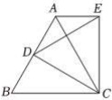
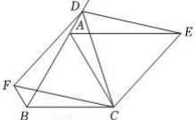

---
id: MAT-8-1-20260829-001-Q25
source: "[[八上-数学-2026北京交大附中期中-20260829#25.]]"
knowledge: ["14-2 三角形全等的判定", "15-3 等腰三角形"]
tags: ["八上数学"]
---

25. （6分）已知，在等边 $\triangle ABC$ 中，点 $D$ 为射线 $BA$ 上一点（点 $D$ 与点 $B$ 不重合），连接 $CD$，以 $DC$ 为边在 $BC$ 上方作等边 $\triangle DCE$，连接 $AE$。

图1

图2

（1）如图1，当点 $D$ 是 $AB$ 边中点时，求 $\angle ADE$ 的度数；

（2）求证：$AE=BD$；

（3）如图2，当动点 $D$ 在 $BA$ 的延长线上时，以 $DC$ 为边在其下方作等边 $\triangle DCF$，连接 $BF$，求线段 $AB$，$AE$，$BF$ 之间的等量关系式。

> [!question]- 点击查看答案与解析
> 【答案】
> （1）$\angle ADE=30^{\circ}$
> （3）$AE=AB+BF$
> 
> 【考点】全等三角形的判定（SAS）、等边三角形的性质 → [[【初中数学知识点体系-人教版】#14-2 三角形全等的判定]]
> 
> 【解析】
> **（1）** 因为 $\triangle ABC$ 和 $\triangle DCE$ 都是等边三角形，
> 所以 $AC=BC$，$DC=EC$，$\angle ACB=\angle DCE=60^{\circ}$。
> 
> 因为 $\angle ACE=\angle ACB-\angle BCE=60^{\circ}-\angle BCE$，
> $\angle BCD=\angle DCE-\angle BCE=60^{\circ}-\angle BCE$，
> 所以 $\angle ACE=\angle BCD$。
> 
> 在 $\triangle ACE$ 和 $\triangle BCD$ 中：
> $\begin{cases} AC=BC \\ \angle ACE=\angle BCD \\ CE=CD \end{cases}$
> 
> 所以 $\triangle ACE\cong\triangle BCD$（SAS），
> 因此 $AE=BD$，$\angle AEC=\angle BDC$。
> 
> 当 $D$ 是 $AB$ 中点时，$CD$ 是等边 $\triangle ABC$ 的中线，也是高和角平分线，
> 所以 $\angle BDC=90^{\circ}$，$\angle BCD=30^{\circ}$。
> 
> 因此 $\angle AEC=\angle BDC=90^{\circ}$。
> 
> 又 $\angle DEC=60^{\circ}$（等边 $\triangle DCE$），
> 所以 $\angle AED=\angle AEC-\angle DEC=90^{\circ}-60^{\circ}=30^{\circ}$。
> 
> 因为 $AE=BD=AD$（$D$ 是中点），所以 $\triangle ADE$ 是等腰三角形，
> $\angle ADE=\angle AED=30^{\circ}$。
> 
> **（2）** 由 $\triangle ACE\cong\triangle BCD$（SAS），直接得 $AE=BD$。
> 
> **（3）** 设 $AB=a$，$AD=x$，则 $BD=a+x$。
> 
> 由（2）的结论，$AE=BD=a+x$。
> 
> 对于等边 $\triangle DCF$（在 $DC$ 下方），类似地可证 $\triangle BCF\cong\triangle ACD$：
> - $BC=AC$（等边 $\triangle ABC$）
> - $CF=CD$（等边 $\triangle DCF$）
> - $\angle BCF=\angle BCD+\angle DCF=\angle BCD+60^{\circ}$
> - $\angle ACD=\angle ACB+\angle BCD=60^{\circ}+\angle BCD$
> - 所以 $\angle BCF=\angle ACD$
> 
> 因此 $\triangle BCF\cong\triangle ACD$（SAS），
> 所以 $BF=AD=x$。
> 
> 因为 $AE=a+x$，$AB=a$，$BF=x$，
> 所以 $AE=AB+BF$。
> 
> 【易错点】不能发现 $\triangle ACE\cong\triangle BCD$ 这一关键全等关系，或无法将（2）的结论推广到（3）的情形。
