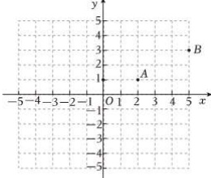
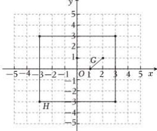

---
id: MAT-8-1-20260829-001-Q26
source: "[[八上-数学-2026北京交大附中期中-20260829#26.]]"
knowledge: ["15-1 图形的轴对称", "7-2 平面直角坐标系"]
tags: ["八上数学"]
---

26. （7分）在平面直角坐标系 $xOy$ 中，对于点 $P$ 和点 $A$，若存在点 $Q$，使得 $\angle PAQ=90^{\circ}$，且 $AQ=AP$，则称点 $Q$ 为点 $P$ 关于点 $A$ 的"链垂点"。

（1）如图1，

图1

$①$ 若点 $A$ 的坐标为 $(2,1)$，则点 $A$ 关于点 $O$ 的"链垂点"坐标为 ___ ；

$②$ 若点 $B(5,3)$ 为点 $O$ 关于点 $C$ 的"链垂点"，且点 $C$ 位于 $x$ 轴上方，试求点 $C$ 的坐标；

（2）如图2，图形 $G$ 是端点为 $(1,0)$ 和 $(2,1)$ 的线段，图形 $H$ 是以点 $O$ 为中心，各边分别与坐标轴平行且边长为 $6$ 的正方形，点 $D$ 为图形 $G$ 上的动点，对于点 $E(0,t)$（$t<0$），存在点 $D$，使得点 $D$ 关于点 $E$ 的"链垂点"恰好在图形 $H$ 上，请直接写出 $t$ 的取值范围。

图2

> [!question]- 点击查看答案与解析
> 【答案】
> （1）$①$ $(-1,2)$ 或 $(1,-2)$
> $②$ $C(1,4)$
> （2）$-3\leq t\leq -2$
> 
> 【考点】平面直角坐标系中的旋转、全等三角形 → [[【初中数学知识点体系-人教版】#15-1 图形的轴对称]]
> 
> 【解析】
> **（1）$①$** 点 $A(2,1)$ 关于点 $O(0,0)$ 的"链垂点" $Q$ 满足：$OQ=OA$，$\angle AOQ=90^{\circ}$。
> 
> 将 $A(2,1)$ 绕 $O$ 逆时针旋转 $90^{\circ}$：$Q_{1}=(-1,2)$。
> 将 $A(2,1)$ 绕 $O$ 顺时针旋转 $90^{\circ}$：$Q_{2}=(1,-2)$。
> 
> 所以"链垂点"坐标为 $(-1,2)$ 或 $(1,-2)$。
> 
> **（1）$②$** 设 $C(a,b)$，$B(5,3)$ 为 $O$ 关于 $C$ 的"链垂点"，
> 则 $CB=CO$，$\angle OCB=90^{\circ}$。
> 
> 由 $CB=CO$：$(5-a)^{2}+(3-b)^{2}=a^{2}+b^{2}$
> 展开得 $25-10a+9-6b=0$，即 $5a+3b=17$ …… $①$
> 
> 由 $\angle OCB=90^{\circ}$：$\vec{CO}\cdot\vec{CB}=0$
> $\vec{CO}=(-a,-b)$，$\vec{CB}=(5-a,3-b)$
> $-a(5-a)-b(3-b)=0$
> $a^{2}+b^{2}=5a+3b$ …… $②$
> 
> 由 $①$ 代入 $②$：$a^{2}+b^{2}=17$。
> 
> 联立 $5a+3b=17$ 和 $a^{2}+b^{2}=17$：
> $b=\frac{17-5a}{3}$，代入 $a^{2}+b^{2}=17$：
> $9a^{2}+(17-5a)^{2}=153$
> $34a^{2}-170a+136=0$
> $a^{2}-5a+4=0$
> $(a-1)(a-4)=0$
> 
> 当 $a=1$ 时，$b=4$，$C(1,4)$（在 $x$ 轴上方，符合）。
> 当 $a=4$ 时，$b=-1$，$C(4,-1)$（在 $x$ 轴下方，不符合）。
> 
> 所以 $C(1,4)$。
> 
> **（2）** 图形 $G$ 的参数方程：$D(1+s, s)$（$0\leq s\leq 1$）。
> 
> 点 $D$ 关于点 $E(0,t)$ 的"链垂点" $Q$ 满足：$EQ=ED$，$\angle DEQ=90^{\circ}$。
> 
> $\vec{ED}=(1+s, s-t)$，旋转 $90^{\circ}$ 得 $\vec{EQ}$：
> - 逆时针：$\vec{EQ}=(-(s-t), 1+s)=(t-s, 1+s)$，$Q=(t-s, 1+s+t)$
> - 顺时针：$\vec{EQ}=(s-t, -(1+s))$，$Q=(s-t, -1-s+t)$
> 
> 图形 $H$ 是边长为 $6$ 的正方形，边界为 $x=\pm 3$（$-3\leq y\leq 3$）和 $y=\pm 3$（$-3\leq x\leq 3$）。
> 
> **逆时针情况**：$Q=(t-s, 1+s+t)$
> 当 $t\in[-3,-2]$，$s\in[0,1]$ 时，$y=1+s+t\in[t, t+2]\subseteq[-3, 0]$，不在上下边界。
> 当 $x=t-s=-3$ 时，$s=t+3\in[0,1]$，$y=2t+4\in[-2, 0]\subseteq[-3, 3]$，符合。
> 
> **顺时针情况**：$Q=(s-t, -1-s+t)$
> 当 $t\in[-3,-2]$，$s\in[0,1]$ 时，$y=-1-s+t\in[t-2, t-1]\subseteq[-5, -3]$。
> 当 $y=-3$ 时，$s=t+2\in[0,1]$，$x=2t+2\in[-4, -2]$。
> 需要 $x\in[-3, 3]$，所以 $2t+2\geq -3$，$t\geq -\frac{5}{2}$。
> 
> 综合两种情况，$t$ 的取值范围为 $-3\leq t\leq -2$。
> 
> 【易错点】不能正确理解"链垂点"的定义（旋转 $90^{\circ}$ 且等距），也无法建立坐标系中的旋转关系和参数方程。
