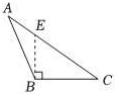
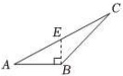
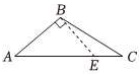
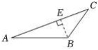

1. （2分）如图，在△ABC中，线段BE表示△ABC的边AC上的高的图是（）

A.

B.

C.

D.

> [!question]- 点击查看答案与解析
> 【答案】D
> 
> 【考点】三角形的高的定义 → [[【初中数学知识点体系-人教版】#13-2 与三角形有关的线段]]
> 
> 【解析】
> 三角形的高是从三角形的一个顶点向对边作垂线，顶点和垂足之间的线段。
> 
> 选项A：图中直角标在 $B$ 处（$BE\perp BC$），$BE$ 不是向 $AC$ 边作的垂线，错误；
> 选项B：图中直角标在 $B$ 处（$BE\perp AB$），$E$ 虽在 $AC$ 上，但 $BE$ 不是从顶点 $B$ 向 $AC$ 作的垂线，错误；
> 选项C：直角是 $\angle ABC=90^{\circ}$，$BE$ 只是 $B$ 到 $AC$ 上一点 $E$ 的连线，不垂直于 $AC$，错误；
> 选项D：$BE$ 过顶点 $B$ 且 $BE\perp AC$，垂足 $E$ 在边 $AC$ 上，符合 $AC$ 边上的高的定义，正确。
> 
> 验证（逐一读原卷四图核对直角标记位置：A、B 的直角均在 $B$ 处（分别垂直于 $BC$、$AB$），C 的直角为 $\angle ABC$，仅 D 的直角标记在 $E$ 处即 $BE\perp AC$）：**修正说明**：原解析对四幅选项图的描述与原卷不符（把 B 误判为"向 AC 延长线作垂线"），答案 B 错误；实际仅 D 中 $BE$ 是 $AC$ 边上的高，答案改为 D。
> 
> 【易错点】高的定义是从顶点向对边（或对边的延长线）作垂线，垂足不一定在对边上，也可能在对边的延长线上。
