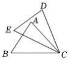

4. （2分）如图，在 $\triangle ABC$ 和 $\triangle DEC$ 中，已知 $CB=CE$，还需添加两个条件才能使 $\triangle ABC \cong \triangle DEC$，不能添加的一组条件是（ ）

A. $AC=DC$ , $AB=DE$

B. $\angle ACD = \angle BCE$ , $\angle B = \angle E$

C. $AB=DE$ , $\angle B = \angle E$

D. $AC=DC$ , $\angle A = \angle D$

> [!question]- 点击查看答案与解析
> 【答案】D
> 
> 【考点】全等三角形的判定条件 → [[【初中数学知识点体系-人教版】#14-2 三角形全等的判定]]
> 
> 【解析】
> 已知$CB=CE$，即$BC=EC$。
> 
> 选项A：$AC=DC$，$AB=DE$，结合$BC=EC$，三边对应相等，可用SSS判定全等；
> 
> 选项B：按图中从 $C$ 出发的射线顺序 $CD$、$CA$、$CE$、$CB$，由 $\angle ACD=\angle BCE$ 两边同加 $\angle ACE$，得 $\angle ACD+\angle ACE=\angle BCE+\angle ACE$，即 $\angle DCE=\angle ACB$。又 $\angle B=\angle E$，结合 $BC=EC$（分别是 $\angle B$、$\angle ACB$ 与 $\angle E$、$\angle DCE$ 的夹边），可用ASA判定全等；
> 
> 选项C：$AB=DE$，$\angle B=\angle E$，结合$BC=EC$，$\angle B$ 是 $AB$ 与 $BC$ 的夹角、$\angle E$ 是 $DE$ 与 $EC$ 的夹角，两边及其夹角对应相等，可用SAS判定全等；
> 
> 选项D：$AC=DC$，$\angle A=\angle D$，结合$BC=EC$，而 $BC$、$EC$ 分别是 $\angle A$、$\angle D$ 的对边，这是SSA（两边及其中一边的对角），不能判定全等。
> 
> 验证（SSA 数值反例：取 $AC=5$、$BC=3$、$\angle A=30^{\circ}$，解得 $AB\approx2.67$ 或 $5.99$ 两个不全等的三角形；选项B、C 的判定链逐项复核成立）：**修正说明**：原解析把选项C 误判为 SSA（实际 $AB$、$BC$ 夹 $\angle B$，是 SAS 可判定），把选项D 误判为 AAS（实际 $BC$ 是 $\angle A$ 的对边，是 SSA 不可判定），答案 C 错误，改为 D；选项B 的角加法也纠正为同加 $\angle ACE$ 得 $\angle DCE=\angle ACB$。
> 
> 【易错点】SSA（两边及其中一边的对角）不能判定三角形全等，这是常见的错误判定方法。
