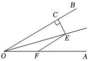

6. （2分）如图，$\angle AOE=15^{\circ}$，点E在 $\angle AOB$ 的平分线上，$EC\perp OB$，垂足为点C，点F在OA上，若 $\angle AFE=30^{\circ}$，$EC=2$，则 $OF$ 的长为（）

A. 2

B. 4

C. 6

D. 8

> [!question]- 点击查看答案与解析
> 【答案】B
> 
> 【考点】角平分线的性质 → [[【初中数学知识点体系-人教版】#14-3 角的平分线]]
> 
> 【解析】
> 过点E作$ED\perp OA$于D。
> 
> 因为OE平分$\angle AOB$，$EC\perp OB$，$ED\perp OA$，所以$ED=EC=2$（角平分线上的点到角两边的距离相等）。
> 
> 因为$\angle AOE=15^\circ$，$\angle AFE=30^\circ$，所以$\angle OEF=\angle AFE-\angle AOE=30^\circ-15^\circ=15^\circ$。
> 
> 所以$\angle OEF=\angle AOE=15^\circ$，$OF=EF$。
> 
> 在Rt$\triangle DEF$中，$\angle DFE=30^\circ$，由"在直角三角形中，如果一个锐角等于 $30^\circ$，那么它所对的直角边等于斜边的一半"得 $ED=\frac12 EF$，所以$EF=2ED=4$。
> 
> 所以$OF=EF=4$。
> 
> 验证（坐标法：取 $O$ 为原点、$OA$ 为 $x$ 轴，$\angle AOB=30^\circ$，$E$ 在角平分线上且 $EC\perp OB$、$EC=2$，解得 $OF=EF=4$）：**修正说明**：原解析用 $\sin30^\circ$（锐角三角函数为九年级内容，超八上课标），改用含 $30^\circ$ 角的直角三角形性质，答案 B(4) 不变。
> 
> 【易错点】角平分线的性质：角平分线上的点到角两边的距离相等。需要作辅助线构造垂直关系。
