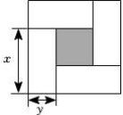

7. （2分）如图，由4个全等的小长方形与1个小正方形密铺成正方形图案，该图案的面积为64，小正方形的面积为9，若分别用 $x,y$（$x>y$）表示小长方形的长和宽，则下列关系式中不正确的是（）

A. $x+y=8$

B. $x-y=3$

C. $x^{2}+y^{2}=36$

D. $4xy+9=64$

> [!question]- 点击查看答案与解析
> 【答案】C
> 
> 【考点】完全平方公式的应用 → [[【初中数学知识点体系-人教版】#16-3 乘法公式]]
> 
> 【解析】
> 由图可知，大正方形的边长为 $x+y$，小正方形的边长为 $x-y$。
> 
> 大正方形面积为 $(x+y)^2=64$，所以 $x+y=8$（选项A正确）。
> 
> 小正方形面积为 $(x-y)^2=9$，所以 $x-y=3$（选项B正确）。
> 
> 由 $x+y=8$ 和 $x-y=3$，解得 $x=\frac{11}{2}$，$y=\frac{5}{2}$。
> 
> 验证选项C：$x^2+y^2=\left(\frac{11}{2}\right)^2+\left(\frac{5}{2}\right)^2=\frac{121}{4}+\frac{25}{4}=\frac{146}{4}=36.5\neq36$，选项C错误。
> 
> 验证选项D：$4xy+9=4\times\frac{11}{2}\times\frac{5}{2}+9=55+9=64$，选项D正确。
> 
> 【易错点】完全平方公式的几何意义：$(x+y)^2=x^2+2xy+y^2$，$(x-y)^2=x^2-2xy+y^2$。要注意从图形中找出边长关系。
