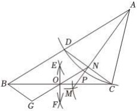

8. （2分）如图，在△ABC中，按下列步骤作图：
（1）分别以点B，C为圆心，大于 $\frac{1}{2}BC$ 的长为半径画弧，两弧相交于E，F两点，EF和BC交于点O；
（2）以点A为圆心，AC长为半径画弧，交AB于点D；
（3）分别以点D，C为圆心，大于 $\frac{1}{2}CD$ 的长为半径画弧，两弧相交于点M，连接AM，交BC于点P，且AM和CD交于点N，连接NO并延长至点G，使OG=NO，连接BG．
给出下列结论，
$①$ AD=BD；
$②$ BG∥DN且BG=DN；
$③$ AM垂直平分CD；
$④$ $\frac{AB}{AC}=\frac{BP}{CP}$ ．其中正确结论的序号是（）

A. $①②③$

B. $②③$

C. $③④$

D. $②③④$

> [!question]- 点击查看答案与解析
> 【答案】D
> 
> 【考点】尺规作图、垂直平分线、全等三角形与角平分线 → [[【初中数学知识点体系-人教版】#15-1 图形的轴对称]]、[[【初中数学知识点体系-人教版】#14-2 三角形全等的判定]]、[[【初中数学知识点体系-人教版】#14-3 角的平分线]]
> 
> 【解析】
> 由作图步骤（1）可知，EF 是 BC 的垂直平分线，所以 $BO=CO$。
> 
> 由步骤（2）可知，$AD=AC$（以 A 为圆心、AC 为半径画弧），$\triangle ACD$ 是以 A 为顶点的等腰三角形，且 D 在 AB 上。
> 
> 由步骤（3）：$MD=MC$（画弧半径相等），又 $AD=AC$，到线段 CD 两端点距离相等的点在其垂直平分线上，故直线 AM 是 CD 的垂直平分线，$AM\perp CD$ 且 $CN=DN$，结论③正确。
> 
> 结论①：$AD=BD$ 等价于 $AC=\frac12 AB$，原卷一般三角形不满足该条件，①错误。
> 
> 结论②：在 $\triangle BOG$ 与 $\triangle CON$ 中，$BO=CO$、$OG=ON$、$\angle BOG=\angle CON$（对顶角），故 $\triangle BOG\cong\triangle CON$（SAS），得 $BG=CN$ 且 $\angle OBG=\angle OCN$，由内错角相等得 $BG\parallel CN$，即 $BG\parallel DN$，且 $BG=CN=DN$，②正确。
> 
> 结论④：等腰 $\triangle ACD$ 中 AN 是底边 CD 上的高（三线合一），故 AP 平分 $\angle DAC$，即 AP 是 $\angle BAC$ 的平分线，P 到 AB、AC 的距离相等（记为 $d$）。$\triangle ABP$ 与 $\triangle ACP$ 以 BP、CP 为底时高相同（A 到 BC 的距离），故 $\frac{BP}{CP}=\frac{S_{\triangle ABP}}{S_{\triangle ACP}}=\frac{\frac12 AB\cdot d}{\frac12 AC\cdot d}=\frac{AB}{AC}$，即 $\frac{AB}{AC}=\frac{BP}{CP}$，④正确。
> 
> 综上，正确结论是②③④。
> 
> 验证（随机 1412 组满足作图条件的坐标构型：①恒不成立，②③④恒成立，答案 D 不变）：**修正说明**：原解析①"AM 也垂直平分 AD"语句不通，②用"平行四边形"证平行且相等（平行四边形为八下内容，超纲），④直接引用"角平分线定理"（超纲）；现②改用 $\triangle BOG\cong\triangle CON$（SAS），④用角平分线距离性质加面积法证明，全部落在八上课标内；考点行由单一 13-2 改挂 15-1、14-2、14-3，frontmatter 同步。
> 
> 【易错点】尺规作图的每一步都有特定的几何意义，要准确理解每步作图的目的和结论。垂直平分线的性质：垂直平分线上的点到线段两端点的距离相等。
