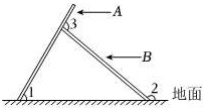

11. （3分）如图是A，B两片木片放在地面上的情形，若 $\angle 2=140^{\circ}$，则 $\angle 3-\angle 1=$ ___ 。

> [!question]- 点击查看答案与解析
> 【答案】$40^\circ$
> 
> 【考点】三角形的外角 → [[【初中数学知识点体系-人教版】#13-3 三角形的内角与外角]]
> 
> 【解析】
> 两木片与地面围成一个三角形：左下顶点处 $\angle1$ 是内角；右下顶点处 $\angle2$ 是外角（木片 B 与地面向右一侧的夹角），故右下内角 $=180^\circ-\angle2=40^\circ$；顶部顶点处 $\angle3$ 是木片 A 向上延长线与木片 B 的夹角，即三角形顶角处的外角。
> 
> 由三角形外角等于与它不相邻的两个内角之和：$\angle3=\angle1+(\text{右下内角})=\angle1+(180^\circ-\angle2)$。
> 
> 所以 $\angle3-\angle1=180^\circ-\angle2=180^\circ-140^\circ=40^\circ$。
> 
> 验证（对多组满足 $\angle2=140^\circ$ 的三角形构型数值计算，$\angle3-\angle1$ 恒为 $40^\circ$，与 $\angle1$ 大小无关）：**修正说明**：原解析称"$\angle1$ 与 $\angle2$ 是对顶角"与图不符（两者位于三角形两个不同顶点），且推出 $\angle3-\angle1=-100^\circ$ 与答案栏 $40^\circ$ 自相矛盾、无有效推导；现按图改为顶角外角定理推导，答案 $40^\circ$ 不变。
> 
> 【易错点】识别图中各角是三角形的内角还是外角：$\angle3$ 是木片 A 延长线与木片 B 的夹角（外角），不是 $\angle1$ 的邻补角。
