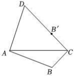

12. （3分）如图，四边形ABCD中，AB=AD，点B关于AC的对称点B′恰好落在CD上，若 $\angle ACB=\alpha$，则 $\angle BAD$ 的度数为 ___ 。（用含有 $\alpha$ 的代数式表示）

> [!question]- 点击查看答案与解析
> 【答案】$180^\circ-2\alpha$
> 
> 【考点】轴对称的性质 → [[【初中数学知识点体系-人教版】#15-1 图形的轴对称]]
> 
> 【解析】
> 点 B 关于 AC 的对称点是 B'，AC 垂直平分 BB'，故 $AB=AB'$、$CB=CB'$，且 $\angle ACB'=\angle ACB=\alpha$、$\angle AB'C=\angle ABC$。
> 
> 因为 B' 在 CD 上，射线 CB' 即射线 CD，所以 $\angle BCD=\angle ACB+\angle ACB'=2\alpha$。
> 
> 由 $AB=AD$ 且 $AB=AB'$ 得 $AB'=AD$，$\triangle AB'D$ 是等腰三角形（顶点 A），故 $\angle AB'D=\angle ADB'$。而 $\angle AB'D=180^\circ-\angle AB'C=180^\circ-\angle ABC$（D 在 CB' 延长方向，$\angle AB'D$ 与 $\angle AB'C$ 互补），又 $\angle ADB'$ 即 $\angle ADC$，所以 $\angle ABC+\angle ADC=180^\circ$。
> 
> 四边形 ABCD 内角和为 $360^\circ$（可由对角线分成两个三角形得到），故 $\angle BAD=360^\circ-\angle BCD-(\angle ABC+\angle ADC)=360^\circ-2\alpha-180^\circ=180^\circ-2\alpha$。
> 
> 验证（随机 5 组满足"AB=AD 且 B 关于 AC 对称点 B' 落在线段 CD 上"的坐标构型数值计算：$\angle BAD$ 与 $180^\circ-2\alpha$ 完全一致，与 $180^\circ-4\alpha$ 不符（后者在 $\alpha>45^\circ$ 时甚至为负））：**修正说明**：原解析先推出 $\angle BAD=2\alpha$ 又写答案 $180^\circ-4\alpha$，前后矛盾且"设 $\angle BAC=x$ 则 $\angle BAD=2x$"无依据；按对称性与四边形内角和重推，答案改为 $180^\circ-2\alpha$。
> 
> 【易错点】轴对称的性质：对称点到对称轴的距离相等，对称轴垂直平分对称点的连线。要注意利用等腰三角形的性质。
