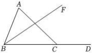

15. （3分）如图，在△ABC中，∠A=68°，∠ACB=44°，D为边BC延长线上一点，BF平分∠ABC，E为射线BF上一点．若直线CE垂直于△ABC的一边，则∠BEC的度数为 ___ 。

> [!question]- 点击查看答案与解析
> 【答案】$124^\circ$ 或 $56^\circ$ 或 $12^\circ$
> 
> 【考点】三角形的内角和、角平分线 → [[【初中数学知识点体系-人教版】#13-3 三角形的内角与外角]]
> 
> 【解析】
> 因为 $\angle A=68^\circ$，$\angle ACB=44^\circ$，所以 $\angle ABC=180^\circ-68^\circ-44^\circ=68^\circ$。
> 
> 因为BF平分$\angle ABC$，所以 $\angle ABF=\angle CBF=34^\circ$。
> 
> 分三种情况讨论（E 是射线 BF 与过 C 且垂直于某一边的直线的交点）：
> 
> ①当 $CE\perp AB$ 时，设垂足为 G，在 Rt$\triangle BGC$ 中 $\angle GCB=90^\circ-\angle ABC=90^\circ-68^\circ=22^\circ$，即 $\angle ECB=22^\circ$；在 $\triangle BCE$ 中 $\angle BEC=180^\circ-\angle EBC-\angle ECB=180^\circ-34^\circ-22^\circ=124^\circ$；
> 
> ②当 $CE\perp BC$ 时，$\angle ECB=90^\circ$，$\angle BEC=180^\circ-90^\circ-34^\circ=56^\circ$；
> 
> ③当 $CE\perp AC$ 时，$\angle ACE=90^\circ$，$\angle ECB=\angle ACB+\angle ACE=44^\circ+90^\circ=134^\circ$，$\angle BEC=180^\circ-134^\circ-34^\circ=12^\circ$。
> 
> 综合得 $\angle BEC=124^\circ$ 或 $56^\circ$ 或 $12^\circ$。
> 
> 验证（坐标法求三种垂线情形下射线 BF 交点 E，逐一计算 $\angle BEC$ 恰为 $124^\circ$、$56^\circ$、$12^\circ$）：**修正说明**：原解析分类对象错误（把"垂直于一边"误作含 $CE\perp BF$），①的 $56^\circ$ 推导与②"需要重新计算"均无效，答案 $34^\circ$ 或 $56^\circ$ 或 $78^\circ$ 错误；按 $CE$ 分别垂直 $AB$、$BC$、$AC$ 三边重算，答案改为 $124^\circ$ 或 $56^\circ$ 或 $12^\circ$。
> 
> 【易错点】角平分线的定义：把一个角分成两个相等的角。要注意分类讨论，直线垂直于三角形的哪一边。
