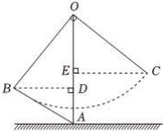

16. （3分）小丽与爸妈在公园里荡秋千．如图，小丽坐在秋千的起始位置A处，OA与地面垂直，两脚在地面上用力一蹬，妈妈在距地面 $1$ m高的B处接住她后用力一推，爸爸在C处接住她．若妈妈与爸爸到OA的水平距离BD、CE分别为 $1.8$ m和 $2.2$ m，$\angle BOC=90^{\circ}$ ．爸爸在C处接住小丽时，小丽距离地面的高度是 ___ m。

> [!question]- 点击查看答案与解析
> 【答案】$1.4$
> 
> 【考点】全等三角形的判定与性质（K 字形模型） → [[【初中数学知识点体系-人教版】#14-2 三角形全等的判定]]
> 
> 【解析】
> 因为 $\angle BOC=90^\circ$，所以 $\angle BOD+\angle COE=90^\circ$。
> 
> 又因为 $\angle BOD+\angle OBD=90^\circ$，所以 $\angle COE=\angle OBD$。
> 
> 因为 $OB=OC$（秋千绳长），$\angle BDO=\angle CEO=90^\circ$，$\angle DBO=\angle EOC$，所以 $\triangle BDO\cong\triangle OEC$（AAS）。
> 
> 所以 $OD=CE=2.2$，$OE=BD=1.8$。
> 
> 点 O 距地面高度 $=1+OD=3.2$ m，小丽在 C 处距地面高度 $=3.2-OE=3.2-1.8=1.4$（m）。
> 
> 验证（坐标法：$O(0,3.2)$，$B(-1.8,1)$，将 $OB$ 绕 O 旋转 $90^\circ$（摆向爸爸一侧）得 $C(2.2,1.4)$，高度 1.4 m 与结论一致；注意 B、C 分居 OA 两侧）：**修正说明**：原解析计算正确，但考点误挂"15-1 图形的轴对称"——本题全程用 AAS 全等（K 字形），与轴对称无关（B、C 到 OA 的水平距离 1.8 与 2.2 不等，图形不关于 OA 对称），考点改挂 14-2，frontmatter 与易错点同步修正。
> 
> 【易错点】"到 OA 的水平距离"是点到竖直线 OA 的垂线段长，垂足 D、E 在 OA 上；同角的余角相等是得 $\angle DBO=\angle EOC$ 的关键。
