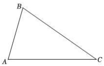

21. （5分）如图，在等腰 $\triangle ABC$ 中，$AC=BC$，$\angle A=2\angle C$

$①$ 请用尺规作图作出 $\angle ABC$ 的角平分线，交AC于点D；

$②$ 作出线段BD的垂直平分线，交BC于点E，交AB于点F；

$③$ 连接ED。

求 $\angle BDE$ 的度数。

> [!question]- 点击查看答案与解析
> 【答案】$36^\circ$
> 
> 【考点】等腰三角形的性质、尺规作图 → [[【初中数学知识点体系-人教版】#15-3 等腰三角形]]
> 
> 【解析】
> 设 $\angle C=x$，则 $\angle A=2x$。
> 
> 因为 $AC=BC$，所以 $\angle A=\angle ABC=2x$。
> 
> 在 $\triangle ABC$ 中，$2x+2x+x=180^\circ$，解得 $x=36^\circ$。
> 
> 所以 $\angle C=36^\circ$，$\angle ABC=72^\circ$。
> 
> 因为BD平分$\angle ABC$，所以 $\angle ABD=\angle CBD=36^\circ$。
> 
> 因为EF垂直平分BD，所以 $BE=DE$。
> 
> 所以 $\angle BDE=\angle DBE=36^\circ$。
> 
> 【易错点】等腰三角形的性质：等边对等角。角平分线的定义。垂直平分线的性质：垂直平分线上的点到线段两端点的距离相等。
