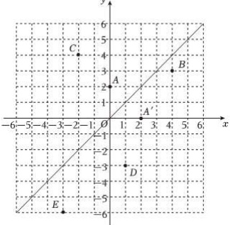

23. （5分）如图，在平面直角坐标系中，直线 $l$ 是第一、三象限的角平分线。

实验与探究：

（1）由图观察易知 $A(0,2)$ 关于直线 $l$ 的对称点 $A'$ 的坐标为 $(2,0)$，在图中分别标明 $B(4,3)$、$C(-2,4)$ 关于直线 $l$ 的对称点 $B'$、$C'$ 的位置，并写出他们的坐标：$B'$ ___ 、$C'$ ___ ；

（2）结合图形观察以上三组点的坐标，你会发现：坐标平面内任一点 $P(a,b)$ 关于第一、三象限的角平分线 $l$ 的对称点 $P'$ 的坐标为 ___ （不必证明）；

运用与拓广：

（3）已知两点 $D(1,-3)$，$E(-3,-6)$，试在直线 $l$ 上确定一点 $Q$，使点 $Q$ 到 $D$、$E$ 两点的距离之和最小，并写出最短距离为 ___ 。

> [!question]- 点击查看答案与解析
> 【答案】（1）$B'(3,4)$，$C'(4,-2)$；（2）$(b,a)$；（3）$Q(-3,-3)$，最短距离 $7$
> 
> 【考点】坐标系中的轴对称与最短路径 → [[【初中数学知识点体系-人教版】#15-2 画轴对称的图形]]、[[【初中数学知识点体系-人教版】#9-2 坐标方法的简单应用]]
> 
> 【解析】
> （1）第一、三象限角平分线的方程是 $y=x$。点关于 $y=x$ 对称，横纵坐标互换。
> 
> 所以 $B(4,3)$ 关于 $y=x$ 的对称点是 $B'(3,4)$，$C(-2,4)$ 的对称点是 $C'(4,-2)$。
> 
> （2）点 $P(a,b)$ 关于直线 $y=x$ 的对称点是 $P'(b,a)$。
> 
> （3）点 $D(1,-3)$ 关于 $y=x$ 的对称点是 $D'(-3,1)$。连接 $D'E$ 交 $y=x$ 于点 $Q$，此时 $QD+QE$ 最小。
> 
> $D'E=\sqrt{(-3+3)^2+(1+6)^2}=7$。$D'E$ 在竖直线 $x=-3$ 上，与 $l:y=x$ 的交点即 $Q(-3,-3)$（在线段 $D'E$ 上），此时 $QD+QE=QD'+QE=D'E=7$ 最小。
> 
> 验证（(1)(2) 换坐标规则逐点复核；(3) 对直线 $y=x$ 上大量 $Q$ 点数值扫描，$QD+QE$ 最小值恰在 $Q(-3,-3)$ 处取得、为 $7$；取 $E$ 关于 $y=x$ 的对称点 $E'(-6,-3)$ 连 $DE'$ 得同一交点与同一最小值 $7$）：**修正说明**：原答案栏（3）误写 $5\sqrt{2}$（约 $7.07$，且二次根式为八下内容），与解析自算结果 $7$ 矛盾，改为 $7$，并补上取最小值时 $Q$ 点坐标；考点行补挂 15-2（用坐标表示轴对称），frontmatter 同步。
> 
> 【易错点】关于第一、三象限角平分线 $y=x$ 对称，横纵坐标互换。关于第二、四象限角平分线 $y=-x$ 对称，横纵坐标互换并取相反数。
