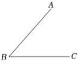
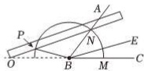
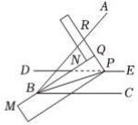
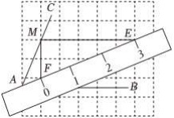
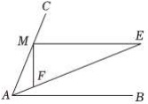

24. （7分）阅读与证明

“三等分任意角”是公元前5世纪古希腊学者提出并致力于研究的三大作图难题之一，其核心要求是仅用圆规和无刻度直尺，将任意给定的角精确分成三个相等的部分。两千多年间，无数数学家为攻克这一难题耗费了大量心血，却始终未能找到通用解法。直到1837年，数学家凡齐尔运用代数方法完成证明，明确了仅靠圆规和直尺无法三等分任意角，这一结论终于让人类走出了这座困扰已久的数学迷宫。不过研究过程中也发现了例外情况：部分特殊度数的角（如直角）仍可用尺规实现三等分；而对于任意角，若借助专门的特殊工具，同样能够完成三等分操作。以下是三种做法，请你认真阅读并完成证明：

图(1) 

图(2) 

图(3) 

（1）阿基米德创设的方法是：在图（2）中，点O为直尺的端点，预先在直尺上作一个记号点P，以B为圆心，OP为半径作半圆，与边BA和BC分别交于点N和M；移动直尺，使直尺上的点O在边BC的反向延长线上移动，点P在圆周上，当直尺恰好经过点N时，过点B画ON的平行线BE．请你依据图（2），完成证明：$\angle EBC=\frac{1}{3}\angle ABC$；

（2）用“有刻度的勾尺”（勾尺的两边互相垂直）的方法是：在图（3）中，勾尺的直角顶点为点P，MN⊥PR于点Q，PQ=QR．画直线DE∥BC，并且DE与BC之间的距离等于PQ．移动勾尺到合适位置，使顶点P落在DE上，使勾尺的边MN经过点B，同时让点R落在边BA上，请你依据图（3），完成证明：$\angle RBQ=\frac{1}{3}\angle ABC$ ．

（3）下面是方圆同学仅仅利用带刻度尺将 $\angle BAC$ 三等分的过程，做法如下：

$①$ 将 $\angle BAC$ 放置在边长为 $0.5\,\text{cm}$ 的正方形网格中，边AB与水平方向的网格线平行，并AC经过格点M，且 $AM=1.5\,\text{cm}$；

$②$ 调整刻度尺的位置，使得刻度尺经过点A，且线段EF（点E、F均在网格线上）的长度为 $3\,\text{cm}$；

$③$ 画射线AE，此时 $\angle BAC=3\angle BAE$。

方圆同学的方法证明过程如下：

已知：如图，$EF=2AM$，$\angle EMF=90^{\circ}$，AB∥EM。

求证：$\angle BAC = 3\angle BAE$ .

作线段 $ME$ 的垂直平分线，交 $AE$ 于点 $D$，连接 $DM$．请你根据提示，作出辅助线，并完成证明．

> [!question]- 点击查看答案与解析
> 【答案】证明见解析
> 
> 【考点】等腰三角形、三角形外角与全等（HL） → [[【初中数学知识点体系-人教版】#15-3 等腰三角形]]、[[【初中数学知识点体系-人教版】#13-3 三角形的内角与外角]]、[[【初中数学知识点体系-人教版】#14-2 三角形全等的判定]]
> 
> 【解析】
> （1）记 $\angle EBC=\alpha$。因 $O$ 在 $BC$ 的反向延长线上且 $BE\parallel ON$，得 $\angle POB=\angle EBC=\alpha$（同位角）。
> 
> 由记号条件 $OP$ 等于半径，而 $P$ 在圆上，故 $OP=PB$，$\angle PBO=\angle POB=\alpha$，于是 $\angle BPN$（$\triangle OPB$ 在顶点 $P$ 处的外角）$=\angle POB+\angle PBO=2\alpha$。
> 
> 又 $BP=BN$（同圆半径），$\angle BNP=\angle BPN=2\alpha$。
> 
> $\angle ABC=\angle NBM$ 是 $\triangle OBN$ 在顶点 $B$ 处的外角，故 $\angle ABC=\angle BON+\angle BNO=\alpha+2\alpha=3\alpha$，即 $\angle EBC=\frac13\angle ABC$。
> 
> （2）因 $MN\perp PR$ 于 $Q$ 且 $PQ=QR$，故 $MN$ 是 $PR$ 的垂直平分线。在 $\triangle BQP$ 与 $\triangle BQR$ 中，$PQ=QR$、$\angle BQP=\angle BQR=90^\circ$、$BQ=BQ$，故 $\triangle BQP\cong\triangle BQR$（SAS），得 $\angle RBQ=\angle QBP$。
> 
> 过 $P$ 作 $PH\perp BC$ 于 $H$。因 $DE\parallel BC$ 且两线间距离等于 $PQ$，而 $P$ 在 $DE$ 上，故 $PH=PQ$。在 Rt$\triangle BHP$ 与 Rt$\triangle BQP$ 中，斜边 $BP=BP$、$PH=PQ$，故 $\triangle BHP\cong\triangle BQP$（HL），得 $\angle QBP=\angle PBH$。
> 
> 射线 $BR$（沿 $BA$）、$BQ$（沿 $MN$）、$BP$、$BH$（沿 $BC$）依次排列，$\angle ABC=\angle RBQ+\angle QBP+\angle PBH=3\angle RBQ$，即 $\angle RBQ=\frac13\angle ABC$。
> 
> （3）作 $ME$ 的垂直平分线交 $AE$ 于 $D$，连 $DM$，则 $DE=DM$，$\angle DME=\angle DEM$。记 $\angle BAE=\beta$：由 $AB\parallel EM$ 得 $\angle DEM=\angle AEM=\angle BAE=\beta$（内错角），故 $\triangle DME$ 的外角 $\angle MDA=2\beta$。
> 
> 由 $\angle EMF=90^\circ$ 得 $\angle DMF=90^\circ-\beta$；Rt$\triangle EMF$ 中 $\angle MFE=90^\circ-\beta$，即 $\angle MFD=90^\circ-\beta=\angle DMF$，故 $DF=DM=DE$，$D$ 是 $EF$ 的中点，$DM=\frac12 EF$。
> 
> 由 $EF=2AM$ 得 $AM=\frac12 EF=DM$，故 $\angle MAE=\angle MDA=2\beta$。
> 
> 因 $M$ 在 $AC$ 上、$D$ 在射线 $AE$ 上，$\angle EAM=\angle MAD=2\beta$，故 $\angle BAC=\angle BAE+\angle EAM=\beta+2\beta=3\beta=3\angle BAE$。
> 
> 验证（(1) 按 $\angle ABC=3\alpha$ 链条数值构型复验；(2) 按 SAS+HL 全等链复验 $\angle RBQ=\angle QBP=\angle PBH$；(3) 取 $AM=1.5$、$EF=3$ 网格构型计算 $\angle BAC\approx3\angle BAE$）：**修正说明**：原解析 (1) 把半径关系误写为 "$OB=OP$"（应为 $OP=PB$），"$\angle BON=\frac12\angle ABC$" 结论与理由均错（应为 $\frac13$，由外角链 $\alpha+2\alpha$ 得出）；(2) 只给结论无推导，补全垂直平分线 + SAS + HL 证明；(3) 原仅一句"作辅助线，利用垂直平分线性质证明"，现按提示补全证明；考点行由 14-2 改挂 15-3、13-3、14-2，frontmatter 同步。
> 
> 【易错点】三等分角问题是古希腊三大几何难题之一，仅用圆规和直尺无法完成。要注意理解每种方法的几何原理。
