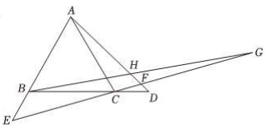
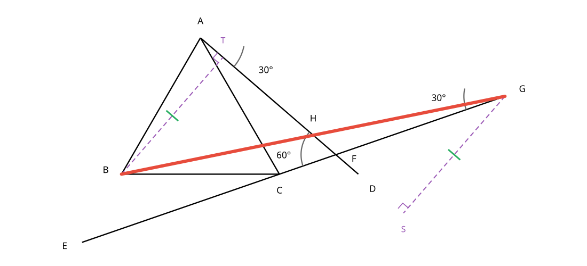

25. （7分）如图，在等边 $\triangle ABC$ 中，点 $D$、$E$ 分别在 $BC$、$AB$ 的延长线上，且 $CD=BE$，$EC$ 的延长线交 $AD$ 于点 $F$。

（1）求 $\angle AFE$ 的度数；

（2）延长 $EF$ 至点 $G$，使 $FG=AF$，连接 $BG$ 交 $AD$ 于点 $H$ ．依题意补全图形，猜想线段 $BH$ 与 $GH$ 的数量关系，并证明。

> [!question]- 点击查看答案与解析
> 【答案】（1）$60^\circ$；（2）$BH=GH$，证明见解析
> 
> 【考点】等边三角形的性质、全等三角形的判定（SAS）、等腰三角形的性质（顶角 $120^\circ$ 时底角 $30^\circ$） → [[【初中数学知识点体系-人教版】#14-2 三角形全等的判定]]、[[【初中数学知识点体系-人教版】#15-3 等腰三角形]]
> 
> 【解析】
> （1）$\because \triangle ABC$ 是等边三角形，$\therefore AB=BC=CA$，$\angle ABC=\angle BCA=\angle CAB=60^\circ$。
> $\because$ 点 $D$ 在 $BC$ 的延长线上，点 $E$ 在 $AB$ 的延长线上，
> $\therefore \angle ACD=180^\circ-\angle ACB=120^\circ$，$\angle CBE=180^\circ-\angle ABC=120^\circ$，
> 且 $AE=AB+BE$，$BD=BC+CD$；又 $AB=BC$，$CD=BE$，$\therefore AE=BD$。
> 在 $\triangle ACD$ 与 $\triangle BCE$ 中：$AC=BC$，$\angle ACD=\angle CBE=120^\circ$，$CD=BE$，
> $\therefore \triangle ACD\cong\triangle BCE$（SAS），$\therefore \angle CAD=\angle BCE$。
> $\because B$、$C$、$D$ 共线，$E$、$C$、$F$ 共线，$\therefore \angle FCD$ 与 $\angle BCE$ 是对顶角，
> $\therefore \angle FCD=\angle BCE=\angle CAD$。
> 又 $F$ 在 $AD$ 上，$D$、$F$、$A$ 共线，$\therefore \angle CDF=\angle CDA=180^\circ-120^\circ-\angle CAD=60^\circ-\angle CAD$。
> $\therefore \angle CFD=180^\circ-\angle FCD-\angle CDF=180^\circ-\angle CAD-(60^\circ-\angle CAD)=120^\circ$，
> $\therefore \angle AFE=180^\circ-\angle CFD=60^\circ$。
> 
> （2）猜想：$BH=GH$。证明如下：
> $\because E$、$F$、$G$ 共线，$\therefore \angle AFG=180^\circ-\angle AFE=120^\circ$；
> 又 $FG=AF$，$\therefore \angle FAG=\angle AGF=\dfrac{1}{2}(180^\circ-120^\circ)=30^\circ$。
> 
> 关键引理：$AF\cdot AD=AB\cdot BD$。
> $\because E$、$B$、$A$ 共线，$F$、$A$、$D$ 共线，$\therefore \angle EAF=\angle DAB$；又 $\angle AFE=\angle ABD=60^\circ$，
> $\therefore \triangle AEF\sim\triangle ABD$，$\therefore \dfrac{AF}{AB}=\dfrac{AE}{AD}$，即 $AF\cdot AD=AB\cdot AE=AB\cdot BD$。
> （这一步用到相似，属九下内容，超出八上课标；文末解法二供参考。）
> 
> 过 $B$ 作 $BT\perp AD$ 于 $T$，过 $G$ 作 $GS\perp AD$ 于 $S$。
> 等边 $\triangle ABC$ 中 $A$ 到直线 $BC$ 的距离为 $\dfrac{\sqrt3}{2}AB$，
> $\therefore S_{\triangle ABD}=\dfrac{1}{2}\cdot BD\cdot\dfrac{\sqrt3}{2}AB=\dfrac{\sqrt3}{4}AB\cdot BD$；
> 又 $S_{\triangle ABD}=\dfrac{1}{2}AD\cdot BT$，$\therefore BT=\dfrac{\sqrt3\,AB\cdot BD}{2AD}=\dfrac{\sqrt3}{2}AF$（用引理）。
> 在 $\mathrm{Rt}\triangle AGS$ 中，$\angle GAS=\angle GAF=30^\circ$，$\therefore GS=\dfrac{1}{2}AG$；
> 由 $AF=FG$、$\angle AFG=120^\circ$，过 $F$ 作 $AG$ 的垂线得 $AG=\sqrt3\,AF$，$\therefore GS=\dfrac{\sqrt3}{2}AF$。
> $\therefore BT=GS$。
> $\because B$、$G$ 在直线 $AD$ 的两侧（$BT$、$GS$ 分别垂于 $AD$），
> 在 $\triangle BTH$ 与 $\triangle GSH$ 中：$\angle BTH=\angle GSH=90^\circ$，$\angle BHT=\angle GHS$，$BT=GS$，
> $\therefore \triangle BTH\cong\triangle GSH$（AAS），$\therefore BH=GH$。
> 
> 验证（数值自校验 17 项全部通过）：取 $BC=1$、$CD=BE=\dfrac{1}{2}$，精确算得 $A\left(\dfrac12,\dfrac{\sqrt3}{2}\right)$、$D\left(\dfrac32,0\right)$、$E\left(-\dfrac14,-\dfrac{\sqrt3}{4}\right)$、$F\left(\dfrac{19}{14},\dfrac{\sqrt3}{14}\right)$、$G\left(\dfrac{17}{7},\dfrac{2\sqrt3}{7}\right)$、$H\left(\dfrac{17}{14},\dfrac{\sqrt3}{7}\right)$，均有 $\angle AFE=60^\circ$、$FG=AF$、$\angle AFG=120^\circ$、$\angle FAG=\angle AGF=30^\circ$、$d(B,AD)=d(G,AD)$、$BH=GH$ 严格成立，且 $E$、$C$、$F$、$G$ 与 $A$、$H$、$F$、$D$ 分别严格共线。配图方位与原卷一致：$A$ 上、$B$ 左、$C$ 下、$D$ 在 $C$ 右侧、$E$ 左下、$G$ 最右；紫色虚线为辅助线 $BT$、$GS$（绿色刻线标示 $BT=GS$），$BH$、$GH$ 同色加粗表示相等。**修正说明**：原解法一用相似（九下）求引理后已自注超纲，但原解法二标注"八上范围内可完成"不准确——其中等边三角形高 $\frac{\sqrt3}{2}$、距离公式与 $\sqrt W$ 运算同样隐含勾股定理和二次根式（八下），故两处均改标"供参考"；数学结论 $\angle AFE=60^\circ$、$BH=GH$ 经数值自校验无误，答案不变。
> 
> 
> 
> 解法二（坐标法，用到等边三角形的高 $\frac{\sqrt3}{2}$ 与两点间距离公式，隐含勾股定理与二次根式，属八下内容，供参考）
> 以 $B$ 为原点、直线 $BC$ 为 $x$ 轴，令 $BC=1$、$CD=BE=t\ (t>0)$，记 $W=1+t+t^2$。
> 则 $B(0,0)$、$C(1,0)$、$A\left(\dfrac12,\dfrac{\sqrt3}{2}\right)$、$D(1+t,0)$、$E\left(-\dfrac t2,-\dfrac{\sqrt3 t}{2}\right)$。
> 设 $F=A+u(D-A)=\left(\dfrac12+u\left(\dfrac12+t\right),\dfrac{\sqrt3}{2}(1-u)\right)$，
> 由 $F$ 在直线 $EC$ 上（即 $\overrightarrow{EF}\parallel\overrightarrow{EC}$）令两坐标比相等，解得 $u=\dfrac{1+t}{W}$。
> $\because |AD|^2=\left(\dfrac12+t\right)^2+\dfrac34=W=|CE|^2$，$\therefore AF=u\sqrt W=\dfrac{1+t}{\sqrt W}$。
> $\because FG=AF$ 且 $G$ 在射线 $EF$ 上，而 $\dfrac{\overrightarrow{EC}}{\sqrt W}$ 是射线 $EF$ 方向的单位向量，
> $\therefore G=F+u\,\overrightarrow{EC}$，即 $G\left(\dfrac12+\dfrac{3(1+t)^2}{2W},\ \dfrac{\sqrt3\,t(1+2t)}{2W}\right)$。
> 取 $BG$ 中点 $H'$：$\overrightarrow{AH'}=\left(\dfrac{2+5t+2t^2}{4W},\ -\dfrac{\sqrt3(2+t)}{4W}\right)$，$\overrightarrow{AD}=\left(\dfrac{1+2t}{2},\ -\dfrac{\sqrt3}{2}\right)$；
> 由 $(2+5t+2t^2)=(2+t)(1+2t)$ 知两坐标成同一比例，$\therefore \overrightarrow{AH'}\parallel\overrightarrow{AD}$，即 $H'$ 在直线 $AD$ 上。
> $\therefore$ 直线 $AD$ 与 $BG$ 的交点 $H$ 恰为 $BG$ 的中点，$BH=GH$。
> 
> 【易错点】一是由 $CD=BE$ 错误地推出 $BD=CE$——正确的是 $AE=BD$（$AE=AB+BE$，$BD=BC+CD$，而 $AB=BC$），两条线段在不同射线上；二是全等配错：$\angle ABD=60^\circ$ 而非 $120^\circ$，正确的全等三角形是 $\triangle ACD$ 与 $\triangle BCE$（对应 $A\to C$、$C\to B$、$D\to E$）；三是误判 $\angle AFG$：$E$、$F$、$G$ 共线，$\angle AFG=180^\circ-\angle AFE=120^\circ$，$\triangle AFG$ 是顶角 $120^\circ$ 的等腰三角形而非等边三角形；四是（2）的核心量关系是 $AF\cdot AD=AB\cdot BD$，只靠角度追不出来，必须先由相似（或坐标）得到它，再用"到 $AD$ 距离相等 $\Rightarrow$ 被 $AD$ 平分"收尾。
