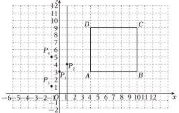
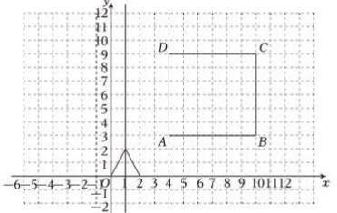
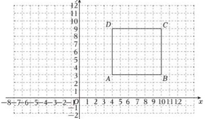

26. （6分）在平面直角坐标系 $xOy$ 中，已知正方形 $ABCD$ 的四个顶点的坐标分别为 A（4,3），，B（10,3），，C（10,9），，D（4,9），，直线 $l$ 为过 M（m,0）且与 x 轴垂直的直线.

对于平面内一点P，直线 $l$，和正方形 ABCD，给出如下定义：若点P关于直线l的对称点P′在正方形ABCD的内部或边上，则称点P为正方形ABCD关于直线l的“镜像点”.

（1）若m=2，如图1，在点 $P_{1}(0,3)$，$P_{2}(1,4)$，$P_{3}(-1,2)$，$P_{4}(-1,6)$ 中，点 ___ 是正方形ABCD关于直线l的“镜像点”；

（2）若m=1，点 E（x，0）（x＜1）关于直线l的对称点为点 F，以 EF 为边，向 x 轴上方作等边 $△EFG$．若 $△EFG$ 的边上存在正方形 ABCD 关于直线 $l$ 的“镜像点”，则 x 的取值范围为 ___ ；（提示：含 30°的直角三角形的三边之比为 1：$\sqrt{3}$：2）

（3）若m=t，已知边长为2的正方形 HIJK 的对角线的交点为 T（0，t），且正方形 HIJK 的边与坐标轴平行．若正方形 HIJK 的边上存在正方形 ABCD 关于直线 $l$ 的“镜像点”，则t的取值范围为 ___ ．

图1 

备用图 

备用图2 

> [!question]- 点击查看答案与解析
> 【答案】（1）$P_1$，$P_4$；（2）$-8-3\sqrt{3}\leq x\leq-2-\sqrt{3}$；（3）$2\leq t\leq\frac{11}{2}$
> 
> 【考点】轴对称（用坐标表示）、坐标系中的新定义 → [[【初中数学知识点体系-人教版】#15-2 画轴对称的图形]]、[[【初中数学知识点体系-人教版】#9-2 坐标方法的简单应用]]
> 
> 【解析】
> 正方形 $ABCD$ 是 $4\leq X\leq10$、$3\leq Y\leq9$（含内部与边上）。$P(x_P,y_P)$ 关于 $l:x=m$ 的对称点 $P'(2m-x_P,\,y_P)$，故"$P$ 是镜像点"等价于 $4\leq2m-x_P\leq10$ 且 $3\leq y_P\leq9$。
> 
> （1）$m=2$：$P'(4-x_P,y_P)$。$P_1(0,3)\to(4,3)$ 在边上（顶点 $A$），是；$P_2(1,4)\to(3,4)$，$3<4$ 在正方形外，不是；$P_3(-1,2)\to(5,2)$，$2<3$，不是；$P_4(-1,6)\to(5,6)$ 在内部，是。所以 $P_1$，$P_4$。
> 
> （2）$m=1$：镜像点条件为 $-8\leq x_P\leq-2$ 且 $3\leq y_P\leq9$。$E(x,0)$、$F(2-x,0)$，等边 $\triangle EFG$ 向 $x$ 轴上方作，高 $=\frac{\sqrt3}{2}EF=\sqrt3(1-x)$，$G(1,\sqrt3(1-x))$。边 $EF$ 在 $x$ 轴上（$y=0<3$）；边 $GF$ 各点横坐标 $\geq1>-2$；故只能在边 $EG$ 上找。$EG$ 所在直线为 $y=\sqrt3(X-x)$，$3\leq y\leq9$ 对应 $X\in[x+\sqrt3,\,x+3\sqrt3]$，需与 $EG$ 上满足 $-8\leq X\leq-2$ 的部分有公共点，即 $x+\sqrt3\leq-2$ 且 $x+3\sqrt3\geq-8$，得 $-8-3\sqrt3\leq x\leq-2-\sqrt3$。
> 
> （3）$m=t$：镜像点条件为 $2t-10\leq x_P\leq2t-4$ 且 $3\leq y_P\leq9$，即需与矩形 $[2t-10,2t-4]\times[3,9]$（宽 $6$、高 $6$）有公共点。正方形 $HIJK$ 为 $[-1,1]\times[t-1,t+1]$（边长 $2$）。该矩形比正方形大，正方形边上存在满足条件的点等价于两图形有公共点：水平方向 $[-1,1]$ 与 $[2t-10,2t-4]$ 有公共部分 $\iff 2t-10\leq1$ 且 $2t-4\geq-1$ $\iff \frac32\leq t\leq\frac{11}{2}$；竖直方向 $[t-1,t+1]$ 与 $[3,9]$ 有公共部分 $\iff t+1\geq3$ 且 $t-1\leq9$ $\iff 2\leq t\leq10$。取交集得 $2\leq t\leq\frac{11}{2}$。
> 
> 验证（数值扫描：(1) 四点镜像依次 True/False/False/True；(2) $x\in[-16,0.5]$ 采样可行区间 $\approx[-13.19,-3.73]$，与 $-8-3\sqrt3\approx-13.20$、$-2-\sqrt3\approx-3.73$ 吻合；(3) $t\in[-2,12]$ 采样可行区间 $\approx[2.01,5.50]$，与 $[2,\frac{11}{2}]$ 吻合）：**修正说明**：原解析 (1) 把 $P_1$ 的镜像 $(4,3)$ 判"在边上"却未计入答案、把 $P_2$ 的镜像 $(3,4)$ 误判"在正方形内部"（$3<4$ 实为外部），答案 $P_2,P_4$ 错误，改为 $P_1,P_4$；(2)(3) 原文只有"需要满足条件，解得"而无推导，答案 $-5\leq x\leq-1$、$-1\leq t\leq11$ 经检验均不成立（如 $x=-1$ 时三角形与带无公共点、$t=0$ 时边上无镜像点），按临界位置分析重写。
> 
> 【易错点】关于直线 $x=m$ 对称，对称点的横坐标为 $2m-x$。要注意正方形内部和边上的点的坐标范围。
