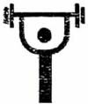
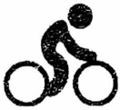
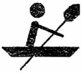
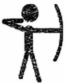

1. “致中和，天地位焉，万物育焉”对称美是我国古人和谐平衡思想的体现，常被运用于建筑、器物、绘画、标志等作品的设计上，使对称之美惊艳了千年的时光。下列常见的运动图标是轴对称图形的是（）

A.

B.

C.

D.

> [!question]- 点击查看答案与解析
> 【答案】A
> 
> 【考点】轴对称图形的概念与判断 → [[【初中数学知识点体系-人教版】#15-1 图形的轴对称]]
> 
> 【解析】
> - 选项A：举重图标沿竖直方向的中线折叠，左右两部分能够完全重合，是轴对称图形；
> - 选项B：自行车图标左右两部分形状不同，折叠后不能重合，不是轴对称图形；
> - 选项C：赛艇图标中人物与船桨偏向一侧，左右不对称，不是轴对称图形；
> - 选项D：射箭图标中弓与手臂只在右侧，左右不对称，不是轴对称图形。
> 
> 【易错点】判断时不能凭“看上去差不多”，而要想象沿某条直线折叠后两部分能否完全重合；对称轴是直线，不是线段。
