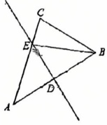

4. 如图，$\triangle ABC$ 中，$\angle A=40^\circ$，$AB$ 的垂直平分线分别交 $AB$，$AC$ 于点 $D$，$E$，连接 $BE$，则 $\angle BEC$ 的大小为（）

A. $40^\circ$

B. $50^\circ$

C. $80^\circ$

D. $100^\circ$

> [!question]- 点击查看答案与解析
> 【答案】C
> 
> 【考点】线段垂直平分线的性质、三角形外角定理 → [[【初中数学知识点体系-人教版】#15-1 图形的轴对称]]、[[【初中数学知识点体系-人教版】#13-3 三角形的内角与外角]]
> 
> 【解析】
> $\because DE$ 是 $AB$ 的垂直平分线，点 $E$ 在 $DE$ 上，
> $\therefore EA=EB$（线段垂直平分线上的点到线段两端的距离相等），
> $\therefore \angle EBA=\angle A=40^\circ$（等边对等角）。
> $\because \angle BEC$ 是 $\triangle ABE$ 的外角，
> $\therefore \angle BEC=\angle A+\angle EBA=40^\circ+40^\circ=80^\circ$。
> 故选C。
> 
> 【易错点】容易把 $\angle BEC$ 直接当成 $\angle A$ 的两倍之外的角而漏掉外角定理；注意 $BE=AE$ 不能推出 $\angle BEC=\angle A$。
