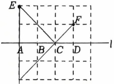

5. 如图，在正方形网格中有 $E$，$F$ 两点，在直线 $l$ 上求一点 $P$，使 $PE + PF$ 最短，则点 $P$ 应选在（）

A. A 点

B. B 点

C. C 点

D. D 点

> [!question]- 点击查看答案与解析
> 【答案】C
> 
> 【考点】利用轴对称求最短路径（将军饮马） → [[【初中数学知识点体系-人教版】#15-2 画轴对称的图形]]
> 
> 【解析】
> 作点 $E$ 关于直线 $l$ 的对称点 $E'$（在 $l$ 下方与 $E$ 对称的格点），连接 $E'F$ 交直线 $l$ 于点 $P$。
> 由对称性得 $PE=PE'$，于是 $PE+PF=PE'+PF$。
> 根据“两点之间线段最短”，$PE'+PF \geq E'F$，当且仅当 $E'$、$P$、$F$ 三点共线时取等号。
> 观察网格，线段 $E'F$ 恰好经过直线 $l$ 上的 $C$ 点，故点 $P$ 应选在 $C$ 点。
> 故选C。
> 
> 【易错点】误把 $E$、$F$ 直接连线与 $l$ 的交点当作答案（那是异侧情形）；本题 $E$、$F$ 在 $l$ 同侧，必须先作对称点。
