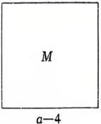
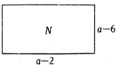

6. 已知 $a > 6$，若正方形 $M$ 的边长为 $(a-4)$，其面积记为 $S_{M}$，长方形 $N$ 的长为 $(a-2)$，宽为 $(a-6)$，其面积记为 $S_{N}$，则 $S_{M}$ 与 $S_{N}$ 的大小关系为（）

A. $S_{N}-S_{M}=2$

B. $S_{M}=S_{N}$

C. $S_{M}-S_{N}=2$

D. $S_{M}-S_{N}=4$

> [!question]- 点击查看答案与解析
> 【答案】D
> 
> 【考点】完全平方公式、多项式乘法、作差比较大小 → [[【初中数学知识点体系-人教版】#16-2 整式的乘法]]、[[【初中数学知识点体系-人教版】#16-3 乘法公式]]
> 
> 【解析】
> $S_M=(a-4)^2=a^2-8a+16$，
> $S_N=(a-2)(a-6)=a^2-8a+12$，
> $\therefore S_M-S_N=(a^2-8a+16)-(a^2-8a+12)=4$，即 $S_M-S_N=4$，故选D。
> 
> 【易错点】展开 $(a-2)(a-6)$ 时符号出错（$-6a-2a=-8a$，$(-2)\times(-6)=+12$）；本题只需作差，不必代入 $a$ 的具体值。
