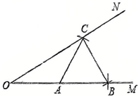

7. 如图，已知 $\angle MON$ 及其边上一点 $A$。以点 $A$ 为圆心，$AO$ 长为半径画弧，分别交 $OM$，$ON$ 于点 $B$ 和 $C$，再以点 $C$ 为圆心，$AC$ 长为半径画弧，恰好经过点 $B$。错误的结论是（）

A. $S_{\triangle AOC} = S_{\triangle ABC}$

B. $\angle OCB = 90^\circ$

C. $\angle MON = 30^\circ$

D. $OC = 2BC$

> [!question]- 点击查看答案与解析
> 【答案】D
> 
> 【考点】等边三角形的判定与性质、等腰三角形的性质、三角形内角和定理 → [[【初中数学知识点体系-人教版】#15-3 等腰三角形]]、[[【初中数学知识点体系-人教版】#13-3 三角形的内角与外角]]
> 
> 【解析】
> 由作图知 $OA=AB=AC$（同圆半径），$CB=CA$（同圆半径），故 $AB=BC=CA$，$\triangle ABC$ 是等边三角形。
> 又 $O$、$A$、$B$ 在同一直线上且 $OA=AB$，所以 $A$ 是 $OB$ 的中点。
> - 选项A：$\triangle AOC$ 与 $\triangle ABC$ 分别以 $OA$、$AB$ 为底，高都是点 $C$ 到直线 $OB$ 的距离，且 $OA=AB$，故面积相等，正确；
> - 选项B：$\because OA=AC$，$\therefore \angle AOC=\angle ACO$；$\because AB=AC$，$\therefore \angle ABC=\angle ACB$。在 $\triangle OCB$ 中 $\angle OCB=\angle OCA+\angle ACB$，故内角和 $\angle AOC+\angle OBC+\angle OCB=\angle ACO+\angle ACB+(\angle ACO+\angle ACB)=2\angle OCB=180^\circ$，$\therefore \angle OCB=90^\circ$，正确；
> - 选项C：$\angle BAC=60^\circ$，又 $O$、$A$、$B$ 共线，$\angle OAC=180^\circ-60^\circ=120^\circ$；在等腰 $\triangle OAC$ 中 $OA=AC$，$\angle AOC=\angle ACO=\frac{180^\circ-120^\circ}{2}=30^\circ$，即 $\angle MON=30^\circ$，正确；
> - 选项D：若 $OC=2BC$：在 $Rt\triangle OCB$ 中 $\angle OCB=90^\circ$、$\angle O=30^\circ$，由"含 $30^\circ$ 角的直角三角形"得 $BC=\frac{1}{2}OB$，即 $OB=2BC$，于是 $OC=OB$，$\therefore \angle OBC=\angle OCB=90^\circ$，出现两个直角，与内角和 $180^\circ$ 矛盾，故 $OC\neq 2BC$，错误（数值上实际 $OC=\sqrt{3}\,BC$）。
> 故选D。
> 
> 【易错点】把 $\angle MON$ 误当作 $60^{\circ}$；证 $\angle OCB=90^{\circ}$ 时误用"直径所对的圆周角"（圆为九年级内容），八年级应改用两组等腰三角形的等边对等角结合内角和；另外由 $BC=\frac{1}{2}OB$ 只能得 $OB=2BC$，不能误推 $OC=2BC$（实际 $OC=\sqrt{3}\,BC$）。
