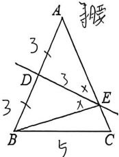

13. 如图，在 $\triangle ABC$ 中，$AB = AC$，$AB$ 的垂直平分线 $DE$，分别交 $AB$，$AC$ 于点 $D$，$E$，若 $AD = 3$，$BC = 5$，则 $\triangle BEC$ 的周长为 ___ .

> [!question]- 点击查看答案与解析
> 【答案】11
> 
> 【考点】线段垂直平分线的性质、等腰三角形的性质 → [[【初中数学知识点体系-人教版】#15-1 图形的轴对称]]、[[【初中数学知识点体系-人教版】#15-3 等腰三角形]]
> 
> 【解析】
> $\because DE$ 是 $AB$ 的垂直平分线，
> $\therefore EA=EB$，且 $D$ 为 $AB$ 的中点。
> $\because AD=3$，$\therefore AB=2AD=6$，又 $AB=AC$，$\therefore AC=6$。
> $\triangle BEC$ 的周长 $=BC+BE+EC=BC+(AE+EC)=BC+AC=5+6=11$。
> 
> 【易错点】把 $DE$ 当成 $AC$ 的垂直平分线，或忘记 $AE=BE$ 的代换；本题关键是 $BE+EC=AC$。
