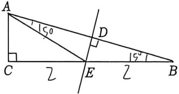

14. 如图，在 $Rt\triangle ABC$ 中，$AB$ 的垂直平分线交 $BC$ 边于点 $E$。若 $BE=2$，$\angle B=15^\circ$，则 $AC=$___ .

> [!question]- 点击查看答案与解析
> 【答案】1
> 
> 【考点】线段垂直平分线的性质、等腰三角形的性质、含 $30^\circ$ 角的直角三角形 → [[【初中数学知识点体系-人教版】#15-1 图形的轴对称]]、[[【初中数学知识点体系-人教版】#15-3 等腰三角形]]
> 
> 【解析】
> $\because$ 点 $E$ 在 $AB$ 的垂直平分线上，
> $\therefore EA=EB=2$，$\therefore \angle EAB=\angle B=15^\circ$。
> $\because \angle AEC$ 是 $\triangle ABE$ 的外角，
> $\therefore \angle AEC=\angle EAB+\angle B=30^\circ$。
> 又 $\angle C=90^\circ$，在 $Rt\triangle ACE$ 中，$\angle AEC=30^\circ$，$AE=2$，
> $\therefore AC=\frac{1}{2}AE=1$。
> 
> 【易错点】没有先由垂直平分线得到 $EA=EB$，从而无法求 $\angle AEC$；另外要看清直角在 $C$ 处（$AB$ 为斜边）。
