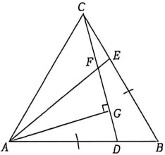
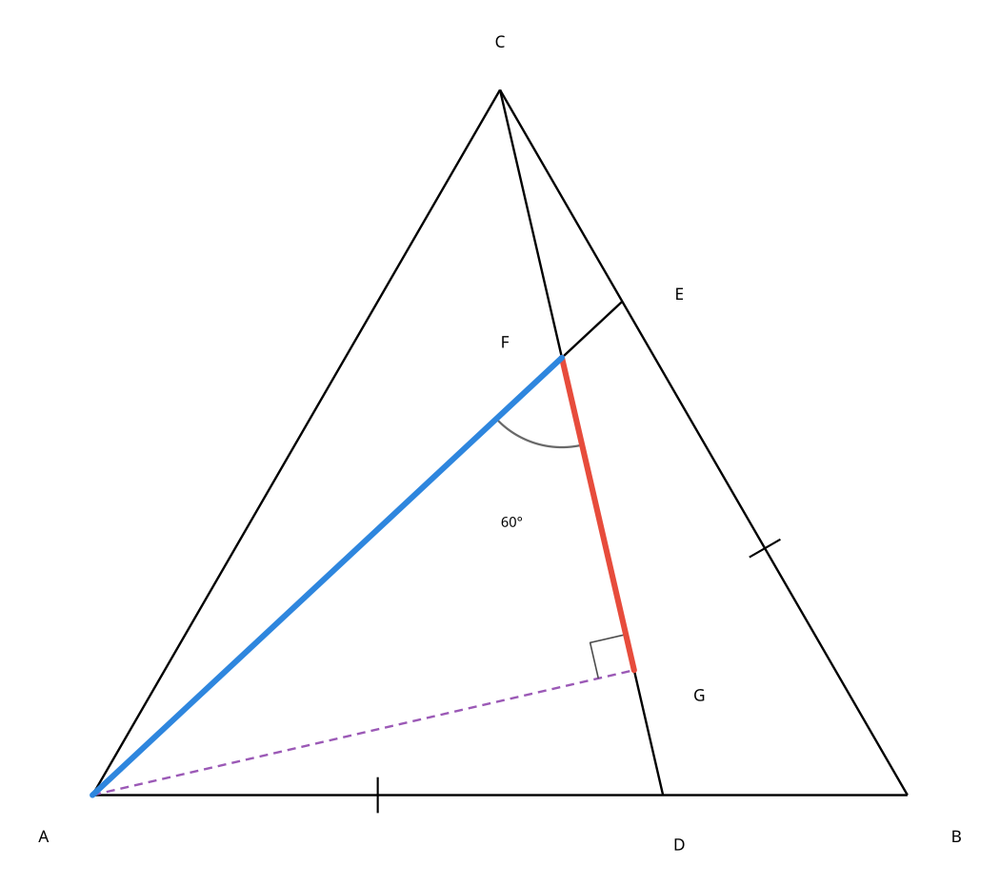

15. 如图，等边三角形 $ABC$ 中，$D$、$E$ 分别为 $AB$、$BC$ 边上的两动点，$AE$ 与 $CD$ 交于点 $F$，$AG \perp CD$ 于点 $G$，若 $AD = BE$，则 $\frac{FG}{AF}=$ ___ .

> [!question]- 点击查看答案与解析
> 【答案】$\frac{1}{2}$
> 
> 【考点】等边三角形的性质 → [[【初中数学知识点体系-人教版】#15-3 等腰三角形]]、全等三角形的判定与性质（SAS） → [[【初中数学知识点体系-人教版】#14-2 三角形全等的判定]]、含 $30^{\circ}$ 角的直角三角形性质 → [[【初中数学知识点体系-人教版】#15-3 等腰三角形]]
> 
> 【解析】
> $\because \triangle ABC$ 是等边三角形，
> $\therefore AB=AC=BC$，$\angle B=\angle BAC=60^\circ$。
> $\because AD=BE$，
> $\therefore \triangle ABE \cong \triangle CAD$（SAS），
> $\therefore \angle BAE=\angle ACD$。
> 在 $\triangle ACF$ 中，
> $\angle AFC=180^\circ-\angle CAF-\angle ACF=180^\circ-(60^\circ-\angle BAE)-\angle ACD=120^\circ$，
> $\therefore \angle AFG=180^\circ-\angle AFC=60^\circ$。
> $\because AG\perp CD$，$\therefore \angle AGF=90^\circ$，在 $Rt\triangle AFG$ 中 $\angle FAG=90^\circ-60^\circ=30^\circ$，
> 由"直角三角形中 $30^\circ$ 角所对的直角边等于斜边的一半"得 $FG=\frac{1}{2}AF$，即 $\frac{FG}{AF}=\frac{1}{2}$。
>
> **动点不变性**：无论 $D$、$E$ 在何处（只要 $AD=BE$），$\angle AFG$ 恒为 $60^\circ$，故比值与动点位置无关——这正是本题"两动点"设定下答案为定值的原因。
>
> 验证（数值自校验全部通过）：取 $AD=BE=0.7$（同原图方位）及 $t=0.25$、$t=0.55$ 三组，均有 $\angle AFC=120^{\circ}$、$\angle AFG=60^{\circ}$、$\angle FAG=30^{\circ}$、$FG/AF=0.5$ 严格成立；$G$ 恒在 $F$ 的 $D$ 侧（射线 $FG$ 即射线 $FD$）。
>
> 
>
> 【易错点】一是把 $\angle AFG$ 误当作 $120^\circ$——$\angle AFC=120^\circ$，而 $G$ 在 $F$ 的 $D$ 侧，$\angle AFG$ 与其互补为 $60^\circ$；二是误以为 $F$ 是 $AE$ 中点（一般不成立）；三是用 $\cos 60^\circ$ 求解——锐角三角函数是九年级内容，八年级应改用"含 $30^\circ$ 角的直角三角形"性质。
