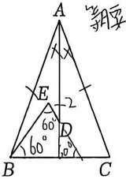

16. 如图所示，在 $\triangle ABC$ 中，$AB=AC$，$D$、$E$ 是 $\triangle ABC$ 内两点，$AD$ 平分 $\angle BAC$，$\angle EBC=\angle E=60^\circ$，若 $BE=6$，$DE=2$，则 $BC$ 的长度是 ___ .

> [!question]- 点击查看答案与解析
> 【答案】8
> 
> 【考点】等腰三角形的性质、等边三角形的判定、含 $30^\circ$ 角的直角三角形 → [[【初中数学知识点体系-人教版】#15-3 等腰三角形]]、[[【初中数学知识点体系-人教版】#14-2 三角形全等的判定]]
> 
> 【解析】
> 设 $AD$ 的延长线交 $BC$ 于 $K$，延长 $ED$ 交 $BC$ 于 $M$。
> $\because AB=AC$，$AD$ 平分 $\angle BAC$，
> $\therefore AK\perp BC$ 且 $BK=CK$（等腰三角形三线合一），故 $BC=2BK$。
> 在 $\triangle BEM$ 中，$\angle MBE=\angle EBC=60^{\circ}$，$\angle BEM=\angle BED=60^{\circ}$，
> $\therefore \angle BME=180^{\circ}-60^{\circ}-60^{\circ}=60^{\circ}$，$\triangle BEM$ 是等边三角形，
> $\therefore EM=BM=BE=6$，
> $\therefore DM=EM-ED=6-2=4$。
> 在 $\mathrm{Rt}\triangle DKM$ 中，$\angle DKM=90^{\circ}$，$\angle DMK=\angle BME=60^{\circ}$（射线 $MK$ 与 $MB$ 重合、射线 $MD$ 与 $ME$ 重合），
> $\therefore \angle KDM=90^{\circ}-60^{\circ}=30^{\circ}$，
> $\therefore KM=\dfrac{1}{2}DM=2$（直角三角形中 $30^{\circ}$ 角所对的直角边等于斜边的一半），
> $\therefore BK=BM-KM=6-2=4$，
> $\therefore BC=2BK=8$。
> 
> 【易错点】误认为 $\triangle EBC$ 是等边三角形（$BC=BE=6$），从而浪费 $DE=2$ 这一条件；注意 $\angle E$ 是 $\angle BED$，并非 $\angle BEC$。
