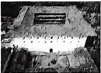
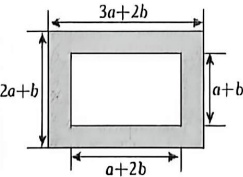
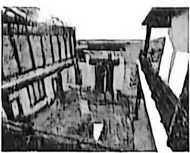
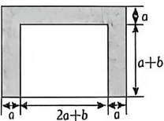

17. 同学们在游学的过程中，遇到了一些各具特色的建筑，有在世界遗产大会上被正式列入《世界遗产名录》的福建土楼，也有被誉为中国民居建筑典范的山西大院。同学们分别对两个建筑物的占地面积（图中阴影）进行了数据测量，数据如图所示。

**图1 回字形福建土楼**

**图2 山西大院**

记图1中回字形福建土楼的占地面积为 $S_{1}$，图2中山西大院的占地面积为 $S_{2}$

（1）若 $b>a>0$，比较 $S_{1}$ 与 $S_{2}$ 的大小：$S_{1}$ ___ $S_{2}$ （填“>”，“=”或“<”）；

（2）若 $\frac{S_{2}}{S_{1}}=\frac{9}{10}$，则 $\frac{a}{b}$ 的值为 ___ .

> [!question]- 点击查看答案与解析
> 【答案】（1）$>$；（2）$\frac{2}{5}$
> 
> 【考点】多项式乘法、整式的化简、作差比较与方程思想 → [[【初中数学知识点体系-人教版】#16-2 整式的乘法]]、[[【初中数学知识点体系-人教版】#16-3 乘法公式]]
> 
> 【解析】
> （1）由图1：外框长 $3a+2b$、宽 $2a+b$，内框长 $a+2b$、宽 $a+b$，
> $S_1=(3a+2b)(2a+b)-(a+2b)(a+b)=(6a^2+7ab+2b^2)-(a^2+3ab+2b^2)=5a^2+4ab$。
> 由图2：上边框宽 $a$、左右边框各宽 $a$，内框长 $2a+b$、宽 $a+b$，
> $S_2=a(4a+b)+2a(a+b)=6a^2+3ab$。
> $S_1-S_2=(5a^2+4ab)-(6a^2+3ab)=ab-a^2=a(b-a)$，
> $\because b>a>0$，$\therefore a(b-a)>0$，即 $S_1>S_2$。
> 
> （2）由 $\frac{S_2}{S_1}=\frac{9}{10}$ 得 $10(6a^2+3ab)=9(5a^2+4ab)$，
> 即 $60a^2+30ab=45a^2+36ab$，
> $\therefore 15a^2=6ab$，$\because a>0$，$\therefore 15a=6b$，$\therefore \frac{a}{b}=\frac{6}{15}=\frac{2}{5}$。
> 
> 【易错点】图2中误把底部也算出一条宽为 $a$ 的边框（图中内框下边与外框重合，底部无边框）；另外展开两个矩形面积时容易漏项。
