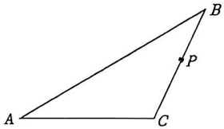
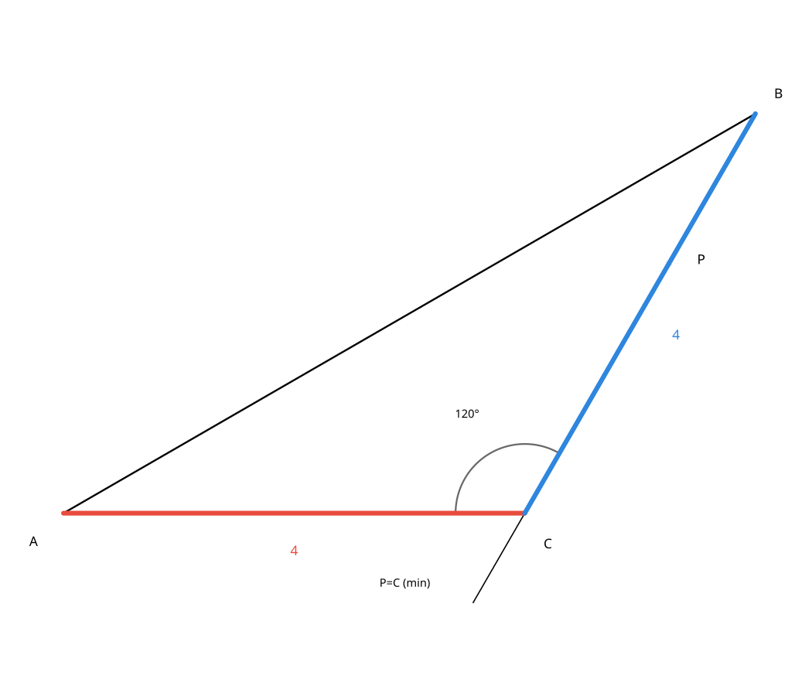
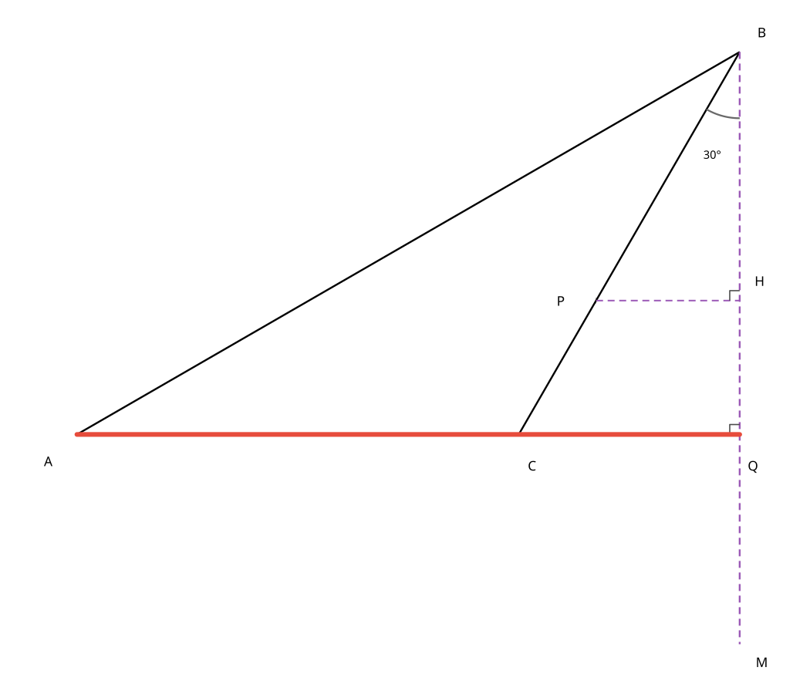

18. 如图，在 $\triangle ABC$ 中，$\angle ACB=120^\circ$，$AC=BC=4$，若 $P$ 是直线 $BC$ 上的动点，则 $PA+\frac{1}{2}PB$ 的最小值是 ___ .

> [!question]- 点击查看答案与解析
> 【答案】6
> 
> 【考点】等腰三角形性质（顶角 $120^{\circ}$、底角 $30^{\circ}$） → [[【初中数学知识点体系-人教版】#15-3 等腰三角形]]、动点最值问题的坐标法、配方法比较二次根式、构造 $30^{\circ}$ 角转化垂线段（垂线段最短）
> 
> 【解析】
> **解法一（坐标 + 配方比较）**（说明：坐标距离公式隐含勾股定理，属八下内容，此解法作为代数验证思路；八上课标内的综合几何证法见解法二）
> 以 $C$ 为原点、直线 $BC$ 为 $x$ 轴，则 $B(4,0)$；$\because \angle ACB=120^{\circ}$，$AC=4$，$\therefore A(-2,2\sqrt{3})$。
> 设 $P(t,0)$，则 $PA=\sqrt{(t+2)^2+12}$，$PB=|t-4|$。
>
> **关键不等式**：对任意 $t$ 恒有 $PA\geq 4+\dfrac{t}{2}$。
> 当 $t\geq -8$ 时两边非负，平方作差：$PA^2-\left(4+\dfrac{t}{2}\right)^2=(t+2)^2+12-\left(16+4t+\dfrac{t^2}{4}\right)=\dfrac{3t^2}{4}\geq 0$，等号当且仅当 $t=0$；当 $t<-8$ 时右边为负，不等式显然成立。
>
> ① 当 $t\leq 4$ 时，$\dfrac{1}{2}PB=\dfrac{4-t}{2}=2-\dfrac{t}{2}$，
> $\therefore PA+\dfrac{1}{2}PB\geq\left(4+\dfrac{t}{2}\right)+\left(2-\dfrac{t}{2}\right)=6$，等号当且仅当 $t=0$，即 $P$ 与 $C$ 重合；
> ② 当 $t>4$ 时，$PA+\dfrac{1}{2}PB>PA\geq 4+\dfrac{t}{2}>6$。
>
> 综上，最小值为 $6$，此时 $P$ 与 $C$ 重合，$PA=AC=4$，$\dfrac{1}{2}PB=\dfrac{1}{2}BC=2$。
>
> 验证（数值自校验 19 项全部通过）：$PA\geq 4+\frac{t}{2}$ 在 $t=-8,-6,-2,0,2,4,6$ 均成立且等号仅在 $t=0$；$f(t)=PA+\frac{1}{2}PB$ 在 $t=0$ 处恰为 $6$，在其余采样点（含 $t>4$ 全程）均严格大于 $6$。
>
> 
>
> **解法二（纯几何：构造 $30^{\circ}$ 角把 $\frac{1}{2}PB$ 转化为垂线段，"胡不归"½型模型）**
> 在直线 $BC$ 的、与 $A$ 异侧的一边作射线 $BM$，使 $\angle CBM=30^{\circ}$。
> 过动点 $P$ 作 $PH\perp BM$ 于 $H$：在 $\mathrm{Rt}\triangle PBH$ 中 $\angle PBH=30^{\circ}$，
> $\therefore PH=\dfrac{1}{2}PB$（$30^{\circ}$ 角所对的直角边等于斜边的一半）。
> $\because \angle ACB=120^{\circ}$，直线 $AC$ 与 $BC$ 的夹角为 $60^{\circ}$，又 $\angle CBM=30^{\circ}$，
> $\therefore$ 直线 $AC\perp BM$，设垂足为 $Q$（在 $AC$ 的延长线上），且 $AQ$ 是点 $A$ 到直线 $BM$ 的垂线段。
> $\therefore PA+\dfrac{1}{2}PB=PA+PH\geq AQ$（垂线段最短）。
> 在 $\mathrm{Rt}\triangle CBQ$ 中 $\angle CBQ=30^{\circ}$，$\therefore CQ=\dfrac{1}{2}CB=2$，
> $AQ=AC+CQ=4+2=6$。
> 等号当且仅当 $P$ 落在垂线段 $AQ$ 上，即 $P$ 与 $C$ 重合，最小值为 $6$。
>
> 
> 
> 【易错点】一是把"直线 $BC$ 上的动点"误当作"线段 $BC$ 上的动点"——本题恰在端点 $P=C$ 处取到最小值；二是忽略 $t>4$（$P$ 在 $BC$ 延长线上）的情形未讨论；三是误用"轴对称将军饮马"（适用于 $PA+PB$ 型）硬套本题——系数 $\frac{1}{2}$ 挂在 $PB$ 上，应改用解法二的"构造 $30^{\circ}$ 转化垂线段"模型（"胡不归"½型）。
