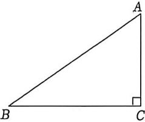

22. （4 分）学习了等腰三角形和尺规作图后，小云进行了拓展性研究，她发现“任意一个直角三角形都可以分割成两个等腰三角形”。下面是小云设计的尺规作图过程.

已知：如图，$Rt\triangle ABC$，$\angle ACB=90^\circ$。

求作：线段 $CD$，使得线段 $CD$ 将 $\triangle ABC$ 分割成两个等腰三角形.

作法：$①$ 作直角边 $BC$ 的垂直平分线 $MN$，交斜边 $AB$ 于点 $D$；

$②$ 连接 $CD$，则线段 $CD$ 即为所求.

根据小云设计的尺规作图过程，

（1）使用直尺和圆规，补全图形（保留作图痕迹）；

（2）完成下面的证明.

证明：∵直线 $MN$ 是线段 $BC$ 的垂直平分线，点 $D$ 在直线 $MN$ 上，

$\therefore DB = DC$（$①$ ___ ）（填推理的依据），

$\therefore \angle B = \angle DCB$（$②$ ___ ）（填推理的依据）.

$\because\angle ACB=90^{\circ}$

$\therefore\angle A=90^{\circ}-\angle B,\quad\angle DCA=90^{\circ}-\angle DCB$

$\therefore\angle A=\angle DCA$

$\therefore DC = DA$（$③$ ___ ）（填推理的依据），

∴ $\triangle DCB$ 和 $\triangle DCA$ 都是等腰三角形.

> [!question]- 点击查看答案与解析
> 【答案】（1）作图：作线段 $BC$ 的垂直平分线 $MN$ 交 $AB$ 于 $D$，连接 $CD$（保留两弧交点及痕迹）；（2）$①$ 线段垂直平分线上的点到线段两端的距离相等；$②$ 等边对等角；$③$ 等角对等边
> 
> 【考点】线段垂直平分线的性质与尺规作图、等腰三角形的判定与性质 → [[【初中数学知识点体系-人教版】#15-1 图形的轴对称]]、[[【初中数学知识点体系-人教版】#15-3 等腰三角形]]
> 
> 【解析】
> （1）分别以 $B$、$C$ 为圆心，大于 $\frac{1}{2}BC$ 的长为半径画弧，两弧交于两点，过这两点作直线 $MN$ 交 $AB$ 于点 $D$，连接 $CD$ 即得所求图形。
> （2）$①$ $\because MN$ 是 $BC$ 的垂直平分线，$D$ 在 $MN$ 上，$\therefore DB=DC$，依据是“线段垂直平分线上的点到这条线段两个端点的距离相等”；
> $②$ 在 $\triangle DBC$ 中 $DB=DC$，$\therefore \angle B=\angle DCB$，依据是“等边对等角”；
> $③$ 由 $\angle A=\angle DCA$ 得 $DC=DA$，依据是“等角对等边”。
> 于是 $\triangle DCB$ 中 $DB=DC$、$\triangle DCA$ 中 $DC=DA$，两个三角形都是等腰三角形。
> 
> 【易错点】证明依据写错（把“等边对等角”与“等角对等边”颠倒）；作图时两弧半径必须大于 $\frac{1}{2}BC$ 且保留弧痕。
