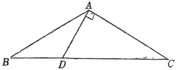

23. （5分）如图，在 $\triangle ABC$ 中，$AB=AC$，$\angle B=30^{\circ}$，$DA\perp AC$，交 $BC$ 于点 $D$。

（1）求 $\angle BAD$ 的度数；

（2）若 $AD=4$，求 $BC$ 的长.

> [!question]- 点击查看答案与解析
> 【答案】（1）$30^\circ$；（2）$12$
> 
> 【考点】等腰三角形的性质、含 $30^\circ$ 角的直角三角形 → [[【初中数学知识点体系-人教版】#15-3 等腰三角形]]、[[【初中数学知识点体系-人教版】#13-3 三角形的内角与外角]]
> 
> 【解析】
> （1）$\because AB=AC$，$\therefore \angle C=\angle B=30^\circ$，
> $\therefore \angle BAC=180^\circ-30^\circ-30^\circ=120^\circ$。
> $\because DA\perp AC$，$\therefore \angle DAC=90^\circ$，
> $\therefore \angle BAD=\angle BAC-\angle DAC=120^\circ-90^\circ=30^\circ$。
> 
> （2）在 $\triangle ABD$ 中，$\angle B=30^\circ$，$\angle BAD=30^\circ$，
> $\therefore \angle B=\angle BAD$，$\therefore AD=BD=4$。
> 在 $Rt\triangle ADC$ 中，$\angle C=30^\circ$，$\angle DAC=90^\circ$，
> $\therefore DC=2AD=8$（$30^\circ$ 角所对的直角边等于斜边的一半）。
> $\therefore BC=BD+DC=4+8=12$。
> 
> 【易错点】把 $\angle BAD$ 误算成 $\angle BAC+\angle DAC$；另外在 $Rt\triangle ADC$ 中，$30^\circ$ 角对着的是 $AD$，故斜边 $DC=2AD$。
