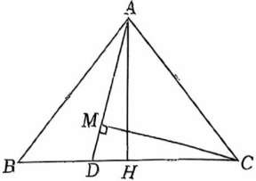
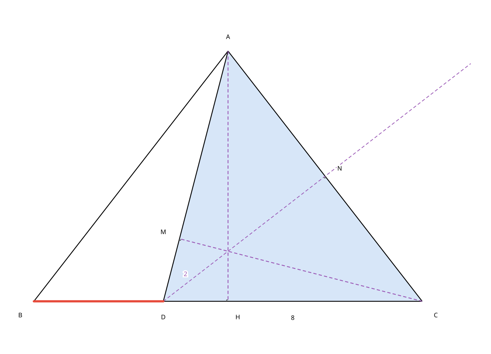

24. （5分）如图，在 $\triangle ABC$ 中，$AB=AC$，点 $D$ 在 $BC$ 上，$D$ 在 $AC$ 的垂直平分线上，连接 $AD$．

（1）若 $AB=10$，$BC=12$，求 $\triangle ABD$ 的周长；

（2）分别过点 $A$，$C$ 作 $AH \perp BC$ 于 $H$、$CM \perp AD$ 于 $M$，若 $DM = 2$，$CD = 8$，求 $BD$ 的长.

> [!question]- 点击查看答案与解析
> 【答案】（1）22；（2）4
> 
> 【考点】线段垂直平分线的性质 → [[【初中数学知识点体系-人教版】#15-1 图形的轴对称]]、等腰三角形三线合一 → [[【初中数学知识点体系-人教版】#15-3 等腰三角形]]、三角形全等的判定（AAS） → [[【初中数学知识点体系-人教版】#14-2 三角形全等的判定]]
> 
> 【解析】
> （1）$\because$ 点 $D$ 在 $AC$ 的垂直平分线上，$\therefore DA=DC$。
> $\triangle ABD$ 的周长 $=AB+BD+AD=AB+BD+DC=AB+BC=10+12=22$。
> 
> （2）辅助线如图（$AH$、$CM$ 为虚线，$DN$ 为 $AC$ 的垂直平分线，$N$ 为 $AC$ 中点）：
>
> $\because AB=AC$ 且 $AH\perp BC$，由等腰三角形三线合一，$\therefore H$ 是 $BC$ 的中点，$BH=CH$。
>
> 在 $\triangle AHD$ 与 $\triangle CMD$ 中：$\angle AHD=\angle CMD=90^{\circ}$；$\angle ADH=\angle CDM$（**公共角** $\angle ADC$：射线 $DH$ 即射线 $DC$，射线 $DM$ 即射线 $DA$）；$AD=CD$（$D$ 在 $AC$ 的垂直平分线上），$\therefore \triangle AHD \cong \triangle CMD$（AAS），$\therefore DH=DM=2$。
>
> $\therefore HC=DC-DH=8-2=6$，$\therefore BC=2HC=12$，$\therefore BD=BC-DC=12-8=4$。
>
> 验证（数值自校验全部通过）：$AD=CD=8$，$AH=\sqrt{AD^{2}-DH^{2}}=2\sqrt{15}$，$AB=AC=\sqrt{36+60}=4\sqrt{6}$，$C$ 到直线 $AD$ 的垂足 $M$ 恰满足 $DM=2$，$BD=4$ 严格成立。
> 
> 
> 
> 【易错点】一是把 $\angle ADH$ 与 $\angle CDM$ 误判为对顶角——实为同一个角（公共角 $\angle ADC$），因 $H$ 在线段 $DC$ 上、$M$ 在线段 $DA$ 上；二是漏用三线合一得到 $H$ 为中点，无法建立 $BC$ 与 $HC$ 的关系；三是全等对应边写错（$DH$ 对应 $DM$，而非 $CM$）。
