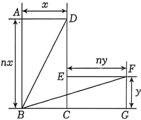

25. （5分）对于任意有理数 $a$、$b$、$c$、$d$，定义一种新运算：$\begin{bmatrix}a&c\\ b&d\end{bmatrix}=a^2+b^2-cd$。

（1）$\begin{bmatrix}1&2\\ -1&3\end{bmatrix}=$ ___ ；

（2）对于有理数 $x$、$y$，若 $x + y = 10$，$xy = 22$。

$①$ 求 $\begin{bmatrix}1 & 1-y^{2}\\x & 1\end{bmatrix}$ 的值；

$②$ 将长方形 $ABCD$ 和长方形 $CEFG$ 按照如图方式进行放置，其中点 $B$、$C$、$G$ 在同一条直线上，点 $E$ 在边 $CD$ 上，连接 $BD$、$BF$。若 $AD = x$，$AB = nx$，$FG = y$，$EF = ny$，图中阴影部分的面积为 45，求 $n$ 的值。

> [!question]- 点击查看答案与解析
> 【答案】（1）$-4$；（2）$①$ $56$；$②$ $n=2$
> 
> 【考点】新定义运算、完全平方公式的变形、整式运算与面积计算 → [[【初中数学知识点体系-人教版】#16-3 乘法公式]]、[[【初中数学知识点体系-人教版】#16-2 整式的乘法]]
> 
> 【解析】
> （1）$\begin{bmatrix}1&2\\ -1&3\end{bmatrix}=1^2+(-1)^2-2\times 3=1+1-6=-4$。
> 
> （2）$①$ $\begin{bmatrix}1&1-y^2\\ x&1\end{bmatrix}=1^2+x^2-(1-y^2)\times 1=1+x^2-1+y^2=x^2+y^2$。
> $\because x+y=10$，$xy=22$，
> $\therefore x^2+y^2=(x+y)^2-2xy=100-44=56$。
> 
> $②$ 长方形 $ABCD$ 中 $AB=nx$、$AD=x$，长方形 $CEFG$ 中 $EF=ny$、$FG=y$，
> 且 $B$、$C$、$G$ 共线，$E$ 在 $CD$ 上，故 $BC=x$，$CG=ny$，$BG=x+ny$，$CE=y$。
> 阴影部分面积 $=S_{ABCD}+S_{CEFG}-S_{\triangle ABD}-S_{\triangle BFG}$
> $=nx\cdot x+ny\cdot y-\frac{1}{2}\cdot nx\cdot x-\frac{1}{2}\cdot y(x+ny)$
> $=\frac{1}{2}n(x^2+y^2)-\frac{1}{2}xy$
> $=\frac{1}{2}\times 56n-\frac{1}{2}\times 22=28n-11$。
> 由 $28n-11=45$，得 $28n=56$，$\therefore n=2$。
> 
> 【易错点】（2）$②$ 中把 $BG$ 误算为 $x+y$（漏掉 $CG=ny$）；面积分割时注意两个直角三角形分别是 $\triangle ABD$ 与 $\triangle BFG$。
