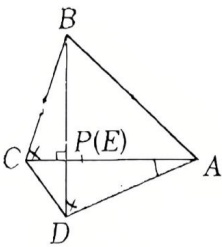
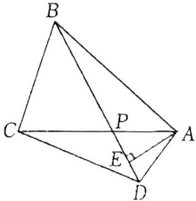
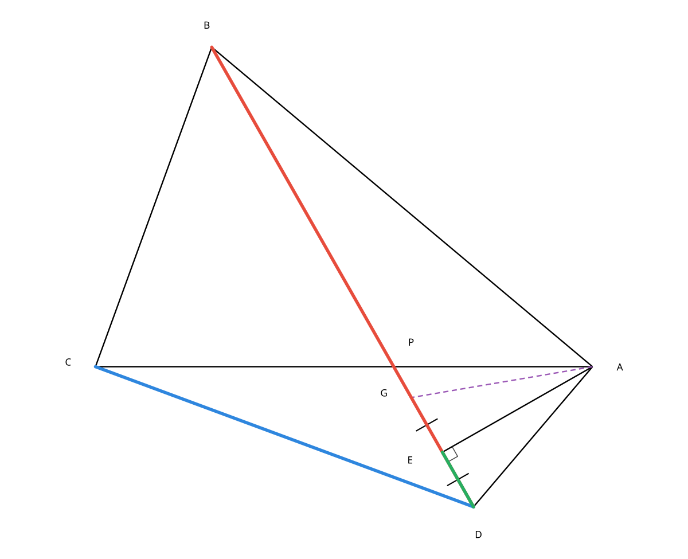

27. （7分）在 $\triangle ABC$ 中，$AB=AC$，$P$ 为 $AC$ 边上一点（不与端点重合），连接 $BP$，在线段 $BP$ 的延长线上取一点 $D$，使 $\angle ADB=\angle ACB$，过 $A$ 点作 $AE\perp BD$，垂足为 $E$，连接 $CD$。

（1）如图1，当点 $E$ 与点 $P$ 重合时，若 $\angle EAD=20^{\circ}$，则 $\angle BAC=$ ___ $^{\circ}$；

（2）如图2，当点 $E$ 与点 $P$ 不重合时，

$①$ 求证：$\angle EAD = \frac{1}{2}\angle BAC$；

$②$ 用等式表示线段 $DE$、$DB$、$DC$ 之间的数量关系，并证明.

**图1**

**图2**

> [!question]- 点击查看答案与解析
> 【答案】（1）40；（2）$①$ 证明见解析；$②$ $DB = DC + 2DE$，证明见解析
> 
> 【考点】等腰三角形的性质、全等三角形的判定与性质、直角三角形的性质 → [[【初中数学知识点体系-人教版】#14-2 三角形全等的判定]]、[[【初中数学知识点体系-人教版】#15-3 等腰三角形]]
> 
> 【解析】
> （1）设 $\angle ABC=\angle ACB=\beta$。
> $\because \angle ADB=\angle ACB=\beta$，$AE\perp BD$，
> $\therefore$ 在 $Rt\triangle AED$ 中，$\angle EAD=90^\circ-\angle ADE=90^\circ-\beta$。
> 由 $\angle EAD=20^\circ$ 得 $\beta=70^\circ$，
> $\therefore \angle BAC=180^\circ-2\beta=40^\circ$。
> 
> （2）$①$ 设 $\angle ABC=\angle ACB=\beta$。
> $\because \angle ADB=\angle ACB=\beta$，且 $AE\perp BD$，
> $\therefore$ 在 $Rt\triangle AED$ 中，$\angle EAD=90^\circ-\angle ADE=90^\circ-\beta$。
> $\because AB=AC$，$\therefore \angle BAC=180^\circ-2\beta$，
> $\therefore \frac{1}{2}\angle BAC=90^\circ-\beta=\angle EAD$，即 $\angle EAD=\frac{1}{2}\angle BAC$。
> 
> $②$ $DB=DC+2DE$。证明如下：
> 在射线 $EB$ 上取点 $G$，使 $EG=ED$，则 $DG=2DE$，且 $AE$ 垂直平分 $DG$，
> $\therefore AD=AG$，$\therefore \angle AGD=\angle ADG=\angle ADB=\beta$。
> $\therefore \angle GAD=180^\circ-2\beta=\angle BAC$。
> 又 $\angle BAG=\angle BAC-\angle CAG$，$\angle CAD=\angle GAD-\angle CAG$，
> $\therefore \angle BAG=\angle CAD$。
> 在 $\triangle BAG$ 与 $\triangle CAD$ 中：
> $AB=AC$，$\angle BAG=\angle CAD$，$AG=AD$，
> $\therefore \triangle BAG \cong \triangle CAD$（SAS），$\therefore BG=CD$。
> $\therefore DB=DG+GB=2DE+DC$，即 $DB=DC+2DE$。
>
> 验证（数值自校验 18 项全部通过）：取底角 $\beta=70^{\circ}$，$P$ 分别位于 $CA$ 上三点（$CP=\frac{9}{10}、\frac{6}{5}、\frac{3}{2}$，边长 $AC=2$），均有 $\angle EAD=\frac{1}{2}\angle BAC$、$AD=AG$、$BG=CD$、$DB=DC+2DE$ 严格成立，且 $B$、$P$、$G$、$E$、$D$ 依次共线。配图方位同原卷图2（$B$ 上、$C$ 左、$A$ 右、$D$ 下），紫色虚线为辅助线 $AG$，$ED$、$EG$ 处有等长刻度，$DB$ 红、$DC$ 蓝、$DE$ 绿。
>
> 
>
> 【易错点】（1）中忘记 $\angle ADB=\angle ACB$ 是解题的关键桥梁；（2）$②$ 需要构造 $EG=ED$ 的辅助点 $G$，否则难以把 $DE$ 与 $DB$、$DC$ 联系起来。
