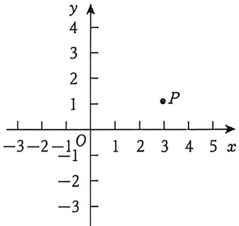
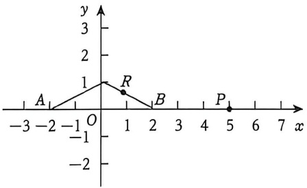
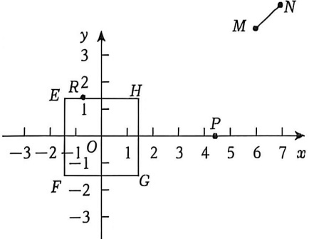

28. （6分）在平面直角坐标系 xOy 中，已知点 $R(a,b)$.

对于点 $P$ 给出如下定义：先将点 $P$ 向右 ($a \geq 0$) 或向左 ($a < 0$) 平移 $|a|$ 个单位长度，再关于直线 $y = b$ 对称，得到点 $P'$，则称点 $P'$ 为点 $P$ 的“$R$ 关联点”。

（1）如图1，点 $P$ 坐标为 $(3,1)$.

$①$ 当点 $R$ 坐标为 $(-1,2)$ 时，则点 $P$ 的“$R$ 关联点” $P'$ 的坐标为 ___ ；

$②$ 若点 $Q(4,-3)$ 为点 $P$ 的“$R$ 关联点”，则 $R$ 的坐标为 ___ ；

（2）如图2，点 $A(-2,0)$、$C(0,1)$，点 $B$ 与点 $A$ 关于 $y$ 轴对称．点 $R$ 在 $\triangle ABC$ 边上，点 $P$ 坐标为 $(5,0)$．

$①$ 画出点 $P$ 所有的“$R$ 关联点”；

$②$ 这些关联点组成的图形形状是：___ .

（3）如图3，点 $E(-n,n)$、$F(-n,-n)$、$G(n,-n)$、$H(n,n)$，$n>0$，点 $R$ 在正方形 $EFGH$ 边上，点 $M(6,4)$、$N(7,5)$，若线段 $MN$ 上存在点 $P(3n,0)$ 的“$R$ 关联点”，直接写出 $n$ 的取值范围.

**图1**

**图2**

**图3**

> [!question]- 点击查看答案与解析
> 【答案】（1）$①$ $(2,3)$；$②$ $(1,-2)$；（2）$①$ 作图见解析；$②$ 三角形；（3）$2\leq n\leq 2.5$ 或 $3\leq n\leq 3.5$
> 
> 【考点】点的平移、关于直线对称的坐标变化、新定义的理解与分类讨论 → [[【初中数学知识点体系-人教版】#15-2 画轴对称的图形]]、[[【初中数学知识点体系-人教版】#9-2 坐标方法的简单应用]]
> 
> 【解析】
> （1）$①$ $a=-1<0$，向左平移 1 个单位得 $(2,1)$，再关于 $y=2$ 对称得 $(2, 2\times 2-1)=(2,3)$。
> $②$ 设 $R(a,b)$。反射后纵坐标为 $2b-1=-3$，$\therefore b=-2$；横坐标为 $3+a=4$，$\therefore a=1$（$a<0$ 时 $3+a=4$ 无解），故 $R(1,-2)$。
> 
> （2）$①$ 设 $R(a,b)$，则 $P(5,0)$ 的“$R$ 关联点”为 $(5+a,2b)$，即把 $R$ 的横坐标加上 5、纵坐标乘以 2。
> 将 $\triangle ABC$ 的三条边按此变换，得到以 $(3,0)$（由 $A(-2,0)$）、$(7,0)$（由 $B(2,0)$）、$(5,2)$（由 $C(0,1)$）为顶点的三角形的三条边，即为所求图形。
> $②$ 由于变换把三角形的边变成三角形的边，故这些点组成的图形是三角形。
> 
> （3）设 $R(a,b)$ 在正方形边上（$-n\leq a\leq n$，$-n\leq b\leq n$），
> 则 $P(3n,0)$ 的“$R$ 关联点”为 $(3n+a,2b)$，
> 其集合是矩形 $[2n,4n]\times[-2n,2n]$ 的边界。
> 线段 $MN$：$y=x-2$（$6\leq x\leq 7$）。
> 分类讨论：
> - 与左边界 $x=2n$ 相交：$2n\in[6,7]$，即 $3\leq n\leq 3.5$，此时 $y=2n-2$ 满足 $-2n\leq y\leq 2n$；
> - 与上边界 $y=2n$ 相交：$x=2n+2\in[6,7]$，即 $2\leq n\leq 2.5$，此时 $x=2n+2\leq 4n$；
> - 与右边界 $x=4n$ 相交：$4n\in[6,7]$ 时 $y=4n-2>2n$，不满足；
> - 与下边界 $y=-2n$ 相交：$x=2-2n\leq 0$，不满足。
> $\therefore n$ 的取值范围是 $2\leq n\leq 2.5$ 或 $3\leq n\leq 3.5$。
> 
> 【易错点】误以为变换后得到的是矩形“内部”的所有点（实际只有边界）；分类讨论时漏掉边界情形（如 $n=2$、$n=3.5$ 等端点）。
