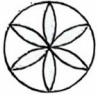
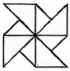
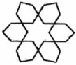
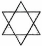

2. （3分）下列图形中，不是轴对称图形的是（）

A.

B.

C.

D.

> [!question]- 点击查看答案与解析
> 【答案】B
> 
> 【考点】轴对称图形的识别 → [[【初中数学知识点体系-人教版】#15-1 图形的轴对称]]
> 
> 【解析】
> 选项A：圆内由六片相同的"花瓣"组成，六片花瓣关于过圆心的多条直线对称，沿这些直线折叠两旁的图形能完全重合，是轴对称图形；
> 选项B：由直角三角形拼成的"风车"图形，绕中心旋转 $90^\circ$ 后能与自身重合（是旋转对称），但沿任意一条直线折叠，两旁的图形都不能完全重合，不是轴对称图形；
> 选项C：由六个全等图形围成的花环，有 $6$ 条对称轴，是轴对称图形；
> 选项D：由两个等边三角形反向叠成的六角星，有 $6$ 条对称轴，是轴对称图形。
> 故选B。
> 
> 【易错点】把"旋转对称"当成"轴对称"：风车、螺旋桨等图形旋转后能重合，但折叠后不能重合；判断轴对称必须用"沿某条直线折叠后两旁完全重合"来验证。
