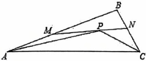

6. （3分）如图，$P$ 为 $\triangle ABC$ 内一点，过点 $P$ 的线段 $MN$ 分别交 $AB$、$BC$ 于点 $M$、$N$，且 $M$、$N$ 分别在 $PA$、$PC$ 的中垂线上。若 $\angle ABC=80^{\circ}$，则 $\angle APC$ 的度数为（ ）

A. $120^{\circ}$

B. $125^{\circ}$

C. $130^{\circ}$

D. $135^{\circ}$

> [!question]- 点击查看答案与解析
> 【答案】C（即 $130^{\circ}$）
> 
> 【考点】线段垂直平分线的性质、等边对等角 → [[【初中数学知识点体系-人教版】#15-1 图形的轴对称]]、三角形内角和与外角 → [[【初中数学知识点体系-人教版】#13-3 三角形的内角与外角]]
> 
> 【解析】
> 因为 $M$ 在 $PA$ 的垂直平分线上，所以 $MA=MP$，由"等边对等角"得 $\angle MAP=\angle APM$；
> 同理 $N$ 在 $PC$ 的垂直平分线上，所以 $NC=NP$，$\angle NCP=\angle NPC$。
> 在 $\triangle BMN$ 中，$\angle BMN+\angle BNM=180^{\circ}-\angle ABC=100^{\circ}$。
> 又 $M$、$P$、$N$ 三点共线，$\angle AMP=\angle AMN=180^{\circ}-\angle BMN$，于是
> $2\angle APM=180^{\circ}-\angle AMP=\angle BMN$，即 $\angle APM=\frac{1}{2}\angle BMN$。
> 同理 $\angle NPC=\frac{1}{2}\angle BNM$。
> 因 $A$、$C$ 在直线 $MN$ 的同侧，$PM$ 与 $PN$ 是相反的两条射线，故
> $\angle APM+\angle APC+\angle NPC=180^{\circ}$，
> 所以 $\angle APC=180^{\circ}-\frac{1}{2}(\angle BMN+\angle BNM)=180^{\circ}-50^{\circ}=130^{\circ}$。
> 逐个选项：A（$120^{\circ}$）、B（$125^{\circ}$）、D（$135^{\circ}$）均不符，只有 $130^{\circ}$ 符合，故选C。
> 
> 【易错点】不会由垂直平分线转化出 $MA=MP$、$NC=NP$，从而找不到 $\angle APM$ 与 $\angle BMN$ 的二倍关系；另外 $P$ 点在 $MN$ 上，$\angle APM$ 与 $\angle NPC$ 是直线 $MN$ 同侧的三个相邻角，容易误判为对顶角或直接相加为 $90^{\circ}$。
