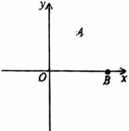

8. （3分）如图，平面直角坐标系中，已知 $A(2,2)$，$B(4,0)$。若在坐标轴上取点 $C$，使 $\triangle ABC$ 为等腰三角形，则满足条件的点 $C$ 的个数是（）

A. 5

B. 6

C. 7

D. 8

> [!question]- 点击查看答案与解析
> 【答案】A
> 
> 【考点】等腰三角形的分类讨论（两腰相等的三种情况） → [[【初中数学知识点体系-人教版】#15-3 等腰三角形]]
> 
> 【解析】
> $AB=\sqrt{(4-2)^2+(0-2)^2}=2\sqrt{2}$。直线 $AB$ 为 $y=-x+4$，在坐标轴上取点时要排除三点共线的情形。
> 情形一：$C$ 在 $x$ 轴上，设 $C(t,0)$，且 $t\neq4$。
> ① $AB=AC$：$(t-2)^2+4=8$，得 $t=0$ 或 $t=4$（$t=4$ 即点 $B$，舍去），得 $C(0,0)$；
> ② $CA=CB$：$(t-2)^2+4=(t-4)^2$，解得 $t=2$，得 $C(2,0)$；
> ③ $BA=BC$：$(t-4)^2=8$，得 $t=4\pm2\sqrt{2}$，得 $C(4+2\sqrt{2},0)$、$C(4-2\sqrt{2},0)$。
> 情形二：$C$ 在 $y$ 轴上，设 $C(0,s)$。
> ① $AB=AC$：$4+(s-2)^2=8$，得 $s=0$ 或 $s=4$；$s=4$ 时 $C(0,4)$ 恰在直线 $AB$ 上，三点共线不能构成三角形，舍去；$s=0$ 即原点，已计入；
> ② $CA=CB$：$4+(s-2)^2=16+s^2$，解得 $s=-2$，得 $C(0,-2)$；
> ③ $BA=BC$：$16+s^2=8$，无解。
> 综上，共有 $C(0,0)$、$(2,0)$、$(4+2\sqrt{2},0)$、$(4-2\sqrt{2},0)$、$(0,-2)$ 共 $5$ 个点。
> 逐个选项：B（$6$）、C（$7$）、D（$8$）均偏多，正确答案为A（$5$）。
> 
> 【易错点】只按一种相等关系（如漏掉"以 $AB$ 为底"的情形）导致漏解；忘记原点同时在两条坐标轴上而重复计数；没有排除 $C(0,4)$（与 $A$、$B$ 共线）这一增解，从而错数成 $6$ 个。
