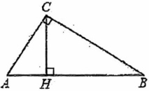

13. （3分）如图，$\triangle ABC$ 中，$\angle ACB=90^\circ$，$\angle B=30^\circ$，$CH \perp AB$ 于 $H$，若 $AH=2$，则 $BH=$ ___ .

> [!question]- 点击查看答案与解析
> 【答案】$6$
> 
> 【考点】含 $30^\circ$ 角的直角三角形的性质 → [[【初中数学知识点体系-人教版】#15-3 等腰三角形]]、直角三角形两锐角互余 → [[【初中数学知识点体系-人教版】#13-3 三角形的内角与外角]]
> 
> 【解析】
> 因为 $\angle ACB=90^\circ$，$\angle B=30^\circ$，所以 $\angle A=90^\circ-30^\circ=60^\circ$。
> 在 Rt$\triangle ACH$ 中，$\angle AHC=90^\circ$，$\angle A=60^\circ$，故 $\angle ACH=30^\circ$，
> 而 $AH$ 是 $\angle ACH$ 所对的直角边，所以 $AC=2AH=2\times2=4$。
> 在 Rt$\triangle ABC$ 中，$\angle B=30^\circ$ 所对的直角边是 $AC$，所以 $AB=2AC=8$。
> 所以 $BH=AB-AH=8-2=6$。
> 验证：$CH=\sqrt{AC^2-AH^2}=\sqrt{16-4}=2\sqrt{3}$，$BC=2CH=4\sqrt{3}$，则 $BH=\sqrt{BC^2-CH^2}=\sqrt{48-12}=6$，结果一致。
> 
> 【易错点】误把 $AH$ 当作"$30^\circ$ 角所对的直角边"去找斜边，导致 $AC$ 与 $AB$ 的关系用错；也常见误记成 $AB=2BC$ 直接算 $BH$。正确顺序是先由互余得 $\angle A=60^\circ$，再在 Rt$\triangle ACH$ 中得 $\angle ACH=30^\circ$。
