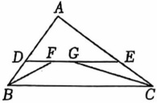

14. （3分）如图，在 $\triangle ABC$ 中，$ED//BC$，$\angle ABC$ 和 $\angle ACB$ 的平分线分别交 $ED$ 于点 $F$、$G$，若 $FG=3$，$ED=8$，则 $DB+EC$ 的值为 ___ 。

> [!question]- 点击查看答案与解析
> 【答案】$5$
> 
> 【考点】角平分线的定义 → [[【初中数学知识点体系-人教版】#14-3 角的平分线]]、平行线与角平分线构造等腰三角形（等角对等边） → [[【初中数学知识点体系-人教版】#15-3 等腰三角形]]
> 
> 【解析】
> 因为 $BF$ 平分 $\angle ABC$，所以 $\angle DBF=\angle FBC$；
> 又 $ED\parallel BC$，$DF$ 所在直线与 $BC$ 平行，由两直线平行内错角相等得 $\angle DFB=\angle FBC$。
> 所以 $\angle DBF=\angle DFB$，由"等角对等边"得 $DB=DF$。
> 同理 $CG$ 平分 $\angle ACB$，$\angle ECG=\angle GCB$，而 $\angle EGC=\angle GCB$（$EG\parallel BC$ 的内错角），
> 所以 $\angle ECG=\angle EGC$，得 $EC=EG$。
> 由图知 $D$、$F$、$G$、$E$ 依次共线，$DF+FG+GE=ED=8$，即
> $DB+3+EC=8$，所以 $DB+EC=5$。
> 验证：$DB=DF$，$EC=EG$，且 $DF+EG=ED-FG=8-3=5$，与所求一致。
> 
> 【易错点】看不出"角平分线 $+$ 平行线"必得等腰三角形这一基本模型，无法把 $DB$、$EC$ 转化成 $DF$、$EG$；线段关系应写成 $ED=DF+FG+GE$，若误写成 $ED=DF+EG-FG$ 会得到 $DB+EC=11$ 的错误结论。
