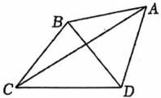

15. （3分）如图，$\triangle ABD$ 是等边三角形，$BC=BD$，$\angle BAC=20^{\circ}$，则 $\angle CBD$ 的度数为 ___ 。

> [!question]- 点击查看答案与解析
> 【答案】$80^{\circ}$
> 
> 【考点】等边三角形的性质 → [[【初中数学知识点体系-人教版】#15-3 等腰三角形]]、三角形内角和 → [[【初中数学知识点体系-人教版】#13-3 三角形的内角与外角]]
> 
> 【解析】
> 因为 $\triangle ABD$ 是等边三角形，所以 $AB=BD$，$\angle ABD=60^\circ$。
> 又 $BC=BD$，所以 $AB=BC$，$\triangle ABC$ 是等腰三角形，底边为 $AC$，
> 故 $\angle BCA=\angle BAC=20^\circ$。
> 在 $\triangle ABC$ 中，$\angle ABC=180^\circ-20^\circ-20^\circ=140^\circ$。
> 由图知射线 $BD$ 落在 $\angle ABC$ 的内部，所以
> $\angle CBD=\angle ABC-\angle ABD=140^\circ-60^\circ=80^\circ$。
> 验证：$\angle CBD=80^\circ$ 且 $BC=BD$，则 $\triangle BCD$ 中 $\angle BCD=\angle BDC=\frac{180^\circ-80^\circ}{2}=50^\circ$，与图中 $C$、$D$ 处的锐角相符。
> 
> 【易错点】没有把 $BC=BD$ 与等边三角形中的 $AB=BD$ 联系起来，看不出 $AB=BC$，从而得不出 $\angle BCA=20^\circ$；也易误认为 $\angle ABC=\angle ABD=60^\circ$ 而漏掉 $\angle CBD$，或把条件 $BC=BD$ 误读成 $BC=CD$。
