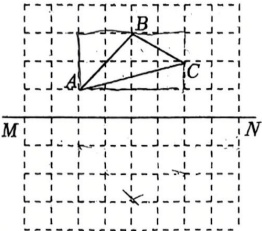

20. （5分）如图所示，由每一个边长均为1的小正方形构成的 $8\times8$ 正方形网格中，点 $A,B,C,M,N$ 均在格点上（小正方形的顶点为格点），利用网格画图。

（1）画出 $\triangle ABC$ 关于直线 $MN$ 对称的 $\triangle A^{\prime}B^{\prime}C^{\prime}$;

（2）$\triangle ABC$ 的面积为 ___ ；

（3）在线段 $MN$ 上找一点 $P$，使得 $\angle APM=\angle CPN$。（保留必要的画图痕迹，并标出点 $P$ 位置）

> [!question]- 点击查看答案与解析
> 【答案】（1）$A^{\prime}(2,3)$、$B^{\prime}(4,1)$、$C^{\prime}(6,2)$，顺次连接得 $\triangle A^{\prime}B^{\prime}C^{\prime}$（如图，在 $MN$ 下方与原三角形对称）；（2）$3$；（3）$P$ 是 $A^{\prime}C$ 与 $MN$ 的交点，位于 $MN$ 上从左起第 $3$、$4$ 条竖格线之间（距左边界 $\frac{10}{3}$ 格处）
> 
> 【考点】画轴对称图形、利用轴对称与对顶角构造等角 → [[【初中数学知识点体系-人教版】#15-2 画轴对称的图形]]、轴对称的性质 → [[【初中数学知识点体系-人教版】#15-1 图形的轴对称]]
> 
> 【解析】
> 以网格左下角格点为原点，格线为坐标轴（每格长 $1$），由网格读数得 $A(2,5)$、$B(4,7)$、$C(6,6)$，直线 $MN$ 是网格中间的那条横格线，即 $y=4$。
> （1）作各点关于 $MN$ 的对称点，横坐标不变、纵坐标关于 $y=4$ 对称（$y\to 8-y$）：
> $A(2,5)\to A^{\prime}(2,3)$，$B(4,7)\to B^{\prime}(4,1)$，$C(6,6)\to C^{\prime}(6,2)$。
> 顺次连接 $A^{\prime}B^{\prime}$、$B^{\prime}C^{\prime}$、$C^{\prime}A^{\prime}$ 即得所求三角形。
> （2）用割补法：取包围 $\triangle ABC$ 的矩形，顶点为 $(2,5)$、$(6,5)$、$(6,7)$、$(2,7)$，面积 $4\times 2=8$；
> 减去三个直角三角形：$\triangle$ 以 $A$、$(2,7)$、$B$ 为顶点（两直角边 $2$、$2$，面积 $2$）；$\triangle$ 以 $B$、$(6,7)$、$C$ 为顶点（两直角边 $2$、$1$，面积 $1$）；$\triangle$ 以 $A$、$(6,5)$、$C$ 为顶点（两直角边 $4$、$1$，面积 $2$）。
> 所以 $S_{\triangle ABC}=8-(2+1+2)=3$。
> 也可用坐标公式：$S=\frac{1}{2}\left|x_A(y_B-y_C)+x_B(y_C-y_A)+x_C(y_A-y_B)\right|=\frac{1}{2}\left|2\times 1+4\times 1-6\times 2\right|=3$。
> （3）点 $A^{\prime}$ 是 $A$ 关于 $MN$ 的对称点，连接 $A^{\prime}C$ 交 $MN$ 于点 $P$，则 $P$ 即为所求（保留 $A^{\prime}C$ 这条线即为画图痕迹）。
> 理由：因 $A$、$A^{\prime}$ 关于 $MN$ 对称，且 $P$ 在 $MN$ 上，故 $MN$ 平分 $\angle APA^{\prime}$，得 $\angle APM=\angle A^{\prime}PM$；
> 又 $A^{\prime}$、$P$、$C$ 三点共线，而 $PM$、$PN$ 是 $MN$ 上方向相反的两条射线，所以 $\angle A^{\prime}PM$ 与 $\angle CPN$ 是对顶角，$\angle A^{\prime}PM=\angle CPN$。
> 综上 $\angle APM=\angle CPN$。
> 求点 $P$ 的位置：$A^{\prime}(2,3)$、$C(6,6)$，直线 $A^{\prime}C$ 上纵坐标 $y=4$ 时，$4=3+\frac{3}{4}(x-2)$，解得 $x=\frac{10}{3}$，即 $P\left(\frac{10}{3},4\right)$；检验：$PA=\left(-\frac{4}{3},1\right)$、$PC=\left(\frac{8}{3},2\right)$，两者与 $MN$ 所成角的正切值均为 $\frac{3}{4}$，故两角相等。
> 
> 【易错点】（1）对称点只看横坐标或把对称轴当成 $x$ 轴，导致上下颠倒、左右错位；（2）数面积时漏减包围矩形外的三角形，或把格点数当成格数（$4$ 格宽不是 $5$ 格）；（3）不会把 $\angle APM=\angle CPN$ 转化为"作对称点后连线"的模型，误在 $MN$ 上随意取点，或忘记利用对顶角，仅凭目测标点。
