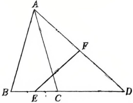

22. （5分）如图，在 $\triangle ABC$ 中，$AB=AC$，$\angle BAC=34^{\circ}$，$D$ 为 $BC$ 延长线上一点，连接 $AD$，使得 $\angle D=40^{\circ}$，$E$ 是 $BC$ 的中点，点 $F$ 是 $AD$ 上一点，连接 $EF$，满足 $EF=AF$。

（1）求 $\angle CAD$ 的度数；

（2）若 $EF=5$，求 $AD$ 的长。

> [!question]- 点击查看答案与解析
> 【答案】（1）$33^{\circ}$；（2）$AD=10$
> 
> 【考点】等腰三角形的性质（等边对等角、三线合一）、三角形内角和与外角 → [[【初中数学知识点体系-人教版】#15-3 等腰三角形]]、三角形内角和 → [[【初中数学知识点体系-人教版】#13-3 三角形的内角与外角]]
> 
> 【解析】
> （1）因为 $AB=AC$，所以 $\angle ABC=\angle ACB=\frac{180^{\circ}-34^{\circ}}{2}=73^{\circ}$。
> 因为 $D$ 在 $BC$ 的延长线上，所以 $\angle ACD=180^{\circ}-73^{\circ}=107^{\circ}$。
> 在 $\triangle ACD$ 中，$\angle CAD=180^{\circ}-\angle ACD-\angle D=180^{\circ}-107^{\circ}-40^{\circ}=33^{\circ}$。
> （2）因为 $AB=AC$，$E$ 是 $BC$ 的中点，由等腰三角形"三线合一"得 $AE\perp BC$，且 $AE$ 平分 $\angle BAC$，
> 所以 $\angle CAE=\frac{1}{2}\angle BAC=17^{\circ}$，且 $\angle AED=90^{\circ}$。
> 又 $F$ 在 $AD$ 上，故 $\angle FAE=\angle EAC+\angle CAD=17^{\circ}+33^{\circ}=50^{\circ}$。
> 因为 $EF=AF$，所以 $\angle AEF=\angle FAE=50^{\circ}$。
> 于是 $\angle FED=90^{\circ}-50^{\circ}=40^{\circ}$，而题设 $\angle D=40^{\circ}$，即 $\angle FED=\angle FDE$。
> 由等角对等边得 $FE=FD$，结合 $EF=AF$ 得 $AF=FD$，即 $F$ 是 $AD$ 的中点。
> 所以 $AD=2AF=2EF=2\times 5=10$。
> （也可在 ${\rm Rt}\triangle AED$ 中用"直角三角形斜边上的中线等于斜边的一半"直接得 $AD=2EF$。）
> 
> 【易错点】不会由 $AB=AC$ 与中点 $E$ 联想到"三线合一"，从而求不出 $\angle AED=90^{\circ}$；求 $\angle EAD$ 时把 $\angle CAD$ 与 $\angle EAC$ 相减（得 $16^{\circ}$），忽略了 $AD$ 与 $AE$ 在 $AC$ 的两侧、应当相加；第（2）问未能发现 $\angle FED=40^{\circ}$ 与 $\angle D$ 相等，因而找不到 $FE=FD$ 这条关键等量关系。
