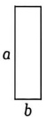
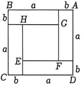
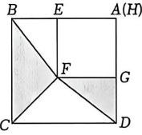

24. （6分）将四个长为 $a$，宽为 $b$ 的长方形如图1，拼成如图2的“回形”正方形 $ABCD$ 和正方形 $EFGH$。
观察与发现：（1）请你观察图2直接写出 $(a+b)^{2}$，$(a-b)^{2}$，$ab$ 之间的一个等量关系式；

运用与探究：（2）根据（1）的结论，解决下列问题：$2x+y=11$，$xy=5$，求 $2x-y$ 的值：

实践与拓展：（3）将两个正方形 $ABCD$，$EFGH$ 如图 3 摆放，若两个正方形面积之和为 65，$BE=3$，求图中阴影部分面积和。

**图1**

**图2**

**图3**

> [!question]- 点击查看答案与解析
> 【答案】（1）$(a+b)^{2}=(a-b)^{2}+4ab$；（2）$2x-y=\pm 9$；（3）阴影部分面积和为 $\frac{33}{2}$（即 $16.5$）
> 
> 【考点】完全平方公式的几何背景与变形 → [[【初中数学知识点体系-人教版】#16-3 乘法公式]]
> 
> 【解析】
> （1）图2的外围正方形 $ABCD$ 边长为 $a+b$，中间的小正方形 $EFGH$ 边长为 $a-b$，四个长方形面积均为 $ab$，由面积拼补得
> $(a+b)^{2}=(a-b)^{2}+4ab$。
> （2）把 $2x$ 与 $y$ 看成（1）中的 $a$、$b$，则 $2x+y=11$ 即 $a+b=11$，$ab=2xy=10$。
> 由 $(a-b)^{2}=(a+b)^{2}-4ab$ 得 $(2x-y)^{2}=11^{2}-4\times 10=121-40=81$，
> 所以 $2x-y=\pm 9$。
> 说明：由 $2x+y=11$、$2xy=10$ 知 $2x$、$y$ 是方程 $t^{2}-11t+10=0$ 的两根，即 $1$ 与 $10$，故 $2x-y$ 可取 $1-10=-9$ 或 $10-1=9$，两个值都成立。
> （3）图3中两正方形 $ABCD$（边长 $a$）、$EFGH$（边长 $b$）摆放时 $H$ 与 $A$ 重合，$E$ 在 $AB$ 上，$G$ 在 $AD$ 上，于是 $BE=AB-AE=a-b=3$。
> 由面积和为 $65$ 得 $a^{2}+b^{2}=65$。由 $(a-b)^{2}=a^{2}+b^{2}-2ab$ 得 $2ab=65-9=56$，故 $ab=28$；
> 又 $(a+b)^{2}=a^{2}+b^{2}+2ab=65+56=121$，且 $a+b>0$，故 $a+b=11$。
> 记 $F$ 为小正方形位于大正方形内部的顶点，阴影为 $\triangle BFC$ 与 $\triangle FGD$（$\triangle BFC$ 以 $BC=a$ 为底，$F$ 到 $BC$ 的距离为 $a-b=3$；$\triangle FGD$ 以 $FG=b$ 为底，$D$ 到 $FG$ 的距离为 $a-b=3$）：
> $S_{\triangle BFC}=\frac{1}{2}\times a\times 3=\frac{3a}{2}$，$S_{\triangle FGD}=\frac{1}{2}\times b\times 3=\frac{3b}{2}$。
> 所以阴影面积和 $=\frac{3a}{2}+\frac{3b}{2}=\frac{3}{2}(a+b)=\frac{3}{2}\times 11=\frac{33}{2}$。
> 检验：$a-b=3$、$a^{2}+b^{2}=65$ 解得 $a=7$、$b=4$（舍去 $a=-4$、$b=-7$），此时阴影面积 $=10.5+6=16.5=\frac{33}{2}$，与上式一致。
> 
> 【易错点】（2）中把 $2x\cdot y$ 误算成 $xy=5$，于是得 $(2x-y)^{2}=121-4\times 5=101$，实际应为 $2x+y=11$ 时"减去 $4\cdot 2x\cdot y=8xy=40$"；另外漏写 $2x-y=-9$ 这一解。（3）中看不出 $BE=a-b=3$、认错阴影对应的三角形（底和高用错边），或把 $a+b$ 的符号取负；还有把 $\frac{3}{2}(a+b)$ 误算成 $3(a+b)$。
