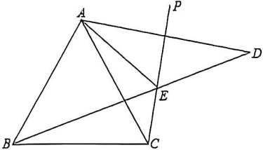

25. （7分）如图，在等边三角形 $ABC$ 右侧作射线 $CP$，$\angle ACP=\alpha(0<\alpha<60^{\circ})$，点 $A$ 关于射线 $CP$ 的对称点为点 $D$，$BD$ 交 $CP$ 于点 $E$，连接 $AD$，$AE$。

（1）求 $\angle DBC$ 的大小（用含 $\alpha$ 的代数式表示）；

（2）在 $\alpha(0^{\circ}<\alpha<60^{\circ})$ 的变化过程中，$\angle AEB$ 的大小是否发生变化？如果发生变化，请直接写出变化的范围；如果不发生变化，请直接写出 $\angle AEB$ 的大小；

（3）用等式表示线段 $AE$，$BD$，$CE$ 之间的数量关系，并证明。

> [!question]- 点击查看答案与解析
> 【答案】（1）$\angle DBC=60^{\circ}-\alpha$；（2）不发生变化，$\angle AEB=60^{\circ}$；（3）$BD=2AE+CE$（即 $BD-CE=2AE$）
> 
> 【考点】等边三角形与等腰三角形的性质、轴对称的性质 → [[【初中数学知识点体系-人教版】#15-3 等腰三角形]]、轴对称的对应线段与对应角 → [[【初中数学知识点体系-人教版】#15-1 图形的轴对称]]、三角形内角和 → [[【初中数学知识点体系-人教版】#13-3 三角形的内角与外角]]
> 
> 【解析】
> （1）由对称得 $CA=CD$，且 $CP$ 平分 $\angle ACD$，故 $\angle ACD=\angle ACP+\angle PCD=2\alpha$。
> 因为 $\triangle ABC$ 是等边三角形，所以 $CA=CB$，$\angle ACB=60^{\circ}$，从而 $CD=CB$，且
> $\angle BCD=\angle BCA+\angle ACD=60^{\circ}+2\alpha$。
> 在等腰 $\triangle BCD$ 中，$\angle DBC=\angle BDC=\frac{180^{\circ}-(60^{\circ}+2\alpha)}{2}=60^{\circ}-\alpha$。
> （2）不发生变化，$\angle AEB=60^{\circ}$。
> 因为 $CA=CD$，所以 $\angle ADC=\frac{180^{\circ}-2\alpha}{2}=90^{\circ}-\alpha$；又 $\angle BDC=60^{\circ}-\alpha$，且射线 $DB$ 在 $\angle ADC$ 内部，
> 故 $\angle ADB=\angle ADC-\angle BDC=(90^{\circ}-\alpha)-(60^{\circ}-\alpha)=30^{\circ}$。
> 因为 $CP$ 是 $AD$ 的垂直平分线，而 $E$ 在 $CP$ 上，所以 $EA=ED$，得 $\angle EAD=\angle EDA=\angle ADB=30^{\circ}$。
> 在 $\triangle AED$ 中，$\angle AED=180^{\circ}-30^{\circ}-30^{\circ}=120^{\circ}$。
> 又 $B$、$E$、$D$ 三点共线（$E$ 在 $BD$ 上），故 $\angle AEB=180^{\circ}-\angle AED=60^{\circ}$，与 $\alpha$ 无关。
> （3）$BD=2AE+CE$。证明如下：
> 在 $\triangle BCE$ 中，$\angle CBE=\angle CBD=60^{\circ}-\alpha$，$\angle BCE=\angle BCA+\angle ACE=60^{\circ}+\alpha$，
> 所以 $\angle BEC=180^{\circ}-(60^{\circ}-\alpha)-(60^{\circ}+\alpha)=60^{\circ}$。
> 结合（2）中 $\angle AEB=60^{\circ}$，可知 $EB$ 平分 $\angle AEC$（$\angle AEC=120^{\circ}$）。
> 作点 $C$ 关于直线 $EB$ 的对称点 $C^{\prime}$，则由 $EB$ 平分 $\angle AEC$ 知 $C^{\prime}$ 落在射线 $EA$ 上，且 $EC^{\prime}=EC$，$BC^{\prime}=BC$。
> 因为 $AB=BC$（等边三角形），所以 $BA=BC^{\prime}$，即点 $B$ 到 $A$、$C^{\prime}$ 的距离相等，故 $B$ 在 $AC^{\prime}$ 的垂直平分线上。
> 设该垂直平分线与直线 $EA$ 交于点 $M$，则 $BM\perp EA$，且 $M$ 是 $AC^{\prime}$ 的中点。
> 因 $A$、$C^{\prime}$ 都在射线 $EA$ 上，所以 $EM=\frac{1}{2}(EA+EC^{\prime})=\frac{1}{2}(AE+CE)$。
> 在 ${\rm Rt}\triangle BEM$ 中，$\angle MEB=60^{\circ}$，$\angle BME=90^{\circ}$，则 $\angle MBE=30^{\circ}$，故 $EM=\frac{1}{2}BE$。
> 于是 $\frac{1}{2}BE=\frac{1}{2}(AE+CE)$，即 $BE=AE+CE$。
> 又由 $E$ 在 $CP$ 上得 $AE=DE$，且 $B$、$E$、$D$ 共线、$E$ 在 $BD$ 上，所以
> $BD=BE+ED=(AE+CE)+AE=2AE+CE$。
> 
> 【易错点】（1）误认为 $\angle ACD=\alpha$（漏掉"对称"导致 $CP$ 平分 $\angle ACD$），或把 $\angle BCD$ 写成 $60^{\circ}-2\alpha$，使答案变成 $60^{\circ}+\alpha$；（2）只由 $\triangle BCD$ 求角，不去用 $EA=ED$ 转化 $\angle AED$，因而误判 $\angle AEB$ 随 $\alpha$ 变化；（3）不会用"EB 平分 $\angle AEC$＋$AB=BC$"作对称点 $C^{\prime}$ 构造等腰与垂直平分线，导致 $BE=AE+CE$ 证不出，或直接把结论写成 $BD=AE+CE$（漏掉 $AE=ED$ 这一步）。
