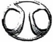
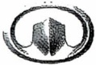
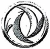
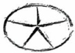

1. （3分）以下国产新能源电动车的车标图案不是轴对称图形的是（）

A.

B.

C.

D.

> [!question]- 点击查看答案与解析
> 【答案】C
> 
> 【考点】轴对称图形的概念与识别 → [[【初中数学知识点体系-人教版】#15-1 图形的轴对称]]
> 
> 【解析】
> 如果一个平面图形沿一条直线折叠，直线两旁的部分能够互相重合，这个图形就是轴对称图形。
> 选项A：左右两个环形图案与中间的尖顶图案关于竖直直线对称，沿这条直线折叠后两旁重合，是轴对称图形；
> 选项B：外形为椭圆，内部两片"羽翼"关于竖直直线对称，是轴对称图形；
> 选项C：图案由两道旋转的弧形构成，不存在任何一条直线能使折叠后的两部分完全重合，不是轴对称图形；
> 选项D：椭圆内部的线条关于竖直直线对称，是轴对称图形。
> 
> 【易错点】不能凭"外形近似圆形或左右看着差不多"就判定为轴对称图形，必须真正找到一条直线，使图形沿它折叠后两旁完全重合；本题C正是外形对称、细节不对称的干扰项。
